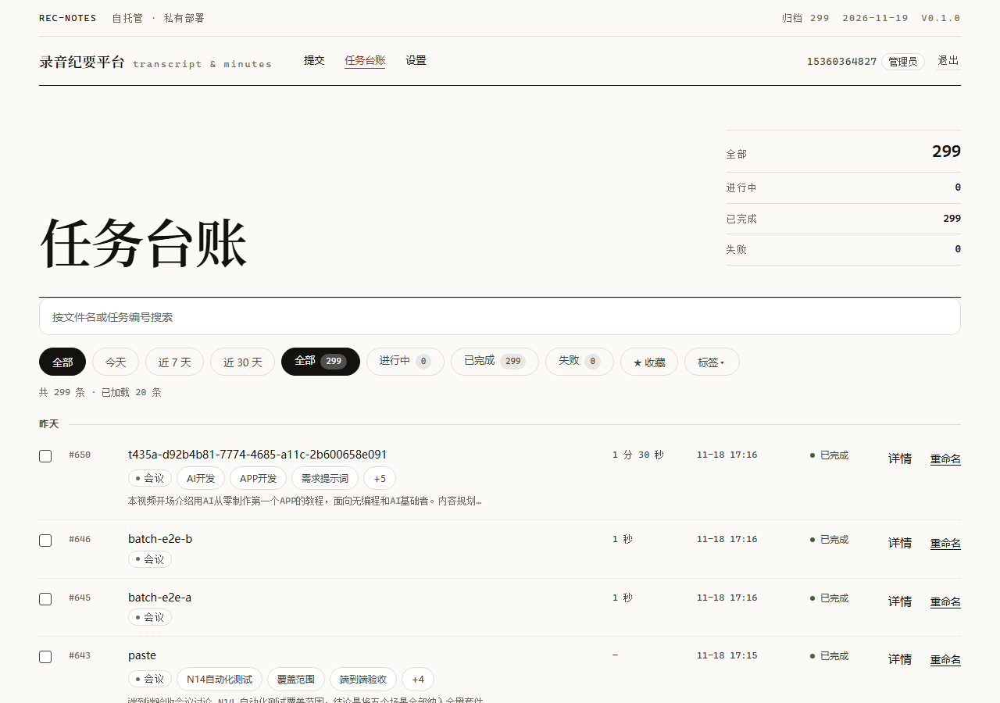
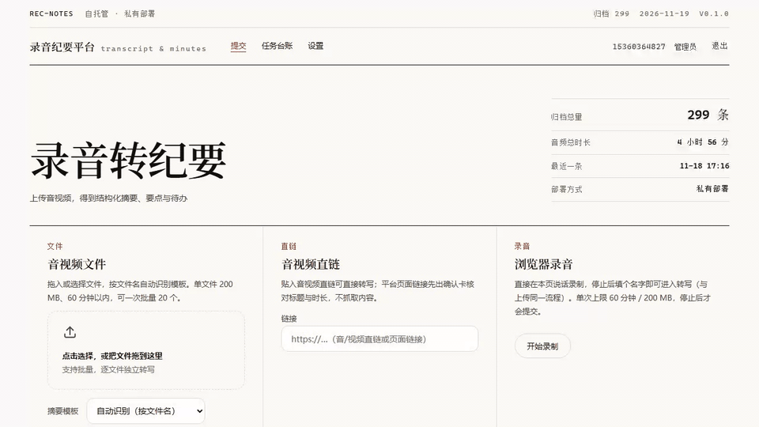

# MeetingNotes · 录音 / 网课 / 短视频 → 结构化纪要 + 待办

[](https://github.com/plus-Liang/meeting-notes/actions/workflows/ci.yml)

> **自托管**：跑在你自己的机器上，音频、转写、纪要全在本地；不需要注册任何第三方账号、不上传云端、不依赖任何第三方服务也能跑通。
> 一个 Docker Compose 起 5 个容器，浏览器打开就能用。

> **当前版本 `v0.1.0`**（[Release 说明](https://github.com/plus-Liang/meeting-notes/releases/tag/v0.1.0)）｜预构建镜像 `ghcr.io/plus-liang/meeting-notes-app` / `-asr` **公开可匿名拉取**，见「方式 B」。



**30 秒演示**（真实界面，无剪辑）：



---

## 这是什么

你有两种东西常常攒着不处理：**一小时的会议录音**、**一门网课的录屏**、**收藏了一堆的短视频**。
把它们丢进来，本系统会：

1. **转写**成带标点、带时间戳的全文（本地 ASR，不用买 API）；
2. 按你选的模板生成 **摘要 / 要点 / 待办 / 关键词**（会议 / 课程 / 访谈 / 播客 / 短视频 五套）；
3. 让你**校对、改错词、标说话人、改名、打标签、搜索筛选**，最后导出 Markdown 或推给你自己的系统。

一句话：**把"听一遍再整理"变成"等几分钟然后校对"。**

## 适合谁 / 不适合谁

**适合**
- 手里攒着大量本地录音/录屏，懒得一个个过剪映转码的人；
- **数据不能出门**（公司会议、客户访谈、内部培训），不能用飞书妙记/通义听悟这类云服务的人；
- 想把它**接进自己系统**：有 REST API、Webhook 签名、OpenAPI，不用打开浏览器也能提交和取结果；
- 想**不花钱**长期用：本地 ASR + 本地/抽取式摘要，零 API 费用。

**不适合**
- 想要手机 App / 微信小程序（本项目只做 Web，刻意不做）；
- 要**实时入会**（腾讯会议/飞书/Zoom 实时转写）——需要平台 SDK/机器人，本项目不做；
- 想把**抖音/小红书/视频号页面链接**直接丢进来下载——本项目不做平台解析器（见下文"链接导入"），只支持直链；
- 要**多租户 SaaS**、要给别人开账号收费——定位是个人/小团队自托管；
- 要**秒级出稿**：一份 56 分钟的音频在这台机器上约 **5.6 分钟**出转写（见实测表）；
- 完全不熟悉 Docker，且不打算学（安装需要命令行）。

## 快速开始（约 10 分钟：首次要下载 461 MB 模型 + 构建镜像；用「方式 B」可省掉构建）

前置：装好 [Docker Desktop](https://www.docker.com/products/docker-desktop/)（或 Linux 上的 Docker + Compose v2），建议 **4 GB 以上内存**、**5 GB 以上空闲磁盘**（镜像约 2 GB + 模型 0.5 GB + 你自己的音频），能访问 Hugging Face（国内强烈建议设镜像，见下）。
Linux/macOS 上若要用 `scripts/*.ps1`（备份/恢复/测试），需另装 [PowerShell 7](https://learn.microsoft.com/powershell/scripting/install/installing-powershell)；**起栈与日常使用不需要**。

### 一键启动（推荐）

```bash
git clone https://github.com/plus-Liang/meeting-notes.git
cd meeting-notes
git checkout v0.1.0        # 可选：锁定已发布版本（不 checkout 则跟 main 最新）

# Linux / macOS（国内建议先设镜像，会快一个数量级）
export HF_ENDPOINT=https://hf-mirror.com
bash scripts/first-run.sh

# Windows PowerShell（国内建议先设镜像）
$env:HF_ENDPOINT = "https://hf-mirror.com"
powershell -NoProfile -ExecutionPolicy Bypass -File scripts\first-run.ps1
```

`first-run` 会依次做四件事：没有 `.env` 就从 `.env.example` 生成 → 下载 ASR 模型到 `./models`（已存在则跳过）→ `docker compose up -d --build` → 轮询到 5 个容器 healthy 并打印访问地址。**模型没下全时 ASR 会明确提示并退出，不会静默卡住。**

### 手动启动（想自己控制每一步）

```bash
cp .env.example .env                                    # Windows: Copy-Item .env.example .env
# 下载模型到 ./models（small 约 461MB）；Windows 用 powershell，装了 PowerShell 7 可换 pwsh
powershell -NoProfile -ExecutionPolicy Bypass -File scripts\download-model.ps1
docker compose up -d --build                            # 之后日常启动约 20 秒
```

### 方式 B：用预构建镜像（可选，跳过本地构建）

不想在本机构建两个镜像（约 10 分钟）时，直接拉 GHCR 上的预构建镜像起栈：

```bash
docker compose -f docker-compose.yml -f docker-compose.ghcr.yml pull   # 首次约 2 GB，视网络 3–10 分钟
docker compose -f docker-compose.yml -f docker-compose.ghcr.yml up -d
# 打开浏览器访问 http://localhost:8080
```

> ⚠️ **镜像不含 ASR 模型**（461 MB）：首次启动仍需跑 `scripts/download-model.ps1` 下载到 `./models`。
> 要固定版本：设环境变量 `MEETING_NOTES_TAG=v0.1.0`（默认 `latest`）。
> 扩容（多副本）前置条件见 [运维-扩容前置清单](docs/项目/录音纪要平台/运维-扩容前置清单.md)；当前发布形态为单实例。

### 打开

- **Web 界面**：<http://localhost:8080>
- 浏览器打开 `/setup` 走安装向导（安装码在终端输出）：五项自检 → 创建管理员 → 完成；向导只在实例未初始化时可用
- 首次进入会引导你**创建管理员账号**；也可直接用 `.env` 里的 `API_TOKEN` 走 API
- API 文档：<http://localhost:8080/swagger-ui.html>

**不填任何 API key 也能完整跑通**：默认走本地 ASR + 抽取式摘要（模型需联网下载一次，之后可离线运行）。想要好一点的摘要再配云 LLM（见"三档 AI"）。

> ⚠️ 首次启动 ASR 要加载模型（small 约 461 MB / 常驻约 700 MB），`docker compose ps` 看到 `asr` healthy 再提交任务，否则第一个任务可能因冷启动超时。
> 💡 国内下载模型：默认直连 `huggingface.co` 实测约 3.5 MB/min（461 MB ≈ 2 小时）；设 `HF_ENDPOINT=https://hf-mirror.com` 实测快一个数量级。

## 核心流程

1. **提交**：把文件拖进首页上传区（支持批量，最多 20 个）、贴一个 http(s) 直链、或直接在浏览器里录一段网页/标签页声音；纯文本可在首页「粘贴文本」区直接提交（或走 REST API：`POST /api/v1/tasks`，见 Swagger UI）；srt / vtt 字幕走 REST API；
2. **等**：任务异步处理，列表里能看到进度与失败原因，失败的可以单独重试；
3. **校对**：全文分句带时间戳、可点句跳转播放；改错词会进**术语表**（下次转写生效）；可标**说话人**；
4. **整理**：摘要/要点/待办/关键词，按模板产出；可**重命名**、打**标签**、收藏；
5. **带走**：导出 Markdown（单条或 zip 批量）、生成 7 天有效的**只读分享链接**、或通过 Webhook 推给自己系统。

> **想录电脑里播放的声音**（网页 / 会议 / 播放器），两条路：
> ① 首页「**录制标签页声音**」按钮——Chrome / Edge，弹窗里选「标签页」并勾选「分享标签页音频」；受版权保护的内容（DRM）录不到；
> ② **系统工具**录好再用「文件」入口上传——Audacity（WASAPI 环回）/ 立体声混音 / VB-Cable / OBS / `ffmpeg -vn` 抽音轨。
> 前提、步骤与限制详见 [接入指南：想录电脑里播放的声音怎么办](docs/项目/录音纪要平台/接入指南.md)。

## 功能清单

| 模块 | 能力 |
|---|---|
| 输入入口 | 上传（mp3/wav/m4a/flac/ogg/opus/amr/mp4/mov/mkv/webm…）、粘贴文本、srt/vtt 字幕、http(s) 直链（L2 直链探测）、浏览器内录音（麦克风；Chrome/Edge 可录标签页音频） |
| 转写 | 本地 faster-whisper（OpenAI 兼容 HTTP），带标点、句子级时间戳；ASR 模型可换档（small/medium…） |
| 结构化 | 5 套模板：会议 / 课程 / 访谈 / 播客 / 短视频；摘要、要点、待办、关键词，`ai_tier` 记录用了哪档模型 |
| 查找整理 | 台账检索（时间范围 / 状态 / **标签多选** / 关键词搜索）、按日期分组、**行内重命名**、标签、收藏、批量操作 |
| 校对 | 分句播放器（点句 seek）、全文/标点双版本、术语表闭环、手工说话人分组 |
| 导出与接入 | Markdown 单条 / zip 批量；只读分享链接（可撤销、7 天过期）；REST API（Bearer）；Webhook（HMAC-SHA256 签名 + 退避重试 + 死信） |
| 运维 | 健康检查、结构化 JSON 日志（按 taskId 捞全链路）、备份/恢复脚本、Flyway 迁移（V1–V9） |
| 账号 | 首次创建管理员、登录/注册开关、单实例多账号数据隔离（同一实例相互看不到对方任务） |

## 五套模板（同一段音频，产出重点不同）

模板在提交时选（默认按文件名自动识别），也可以在详情页换模板重跑。五套输出同样的四节——摘要 / 要点 / 待办 / 关键词——只换"怎么组织"：

| 模板 | 摘要怎么组织 | 适合 |
|---|---|---|
| **会议** `meeting`（默认） | 议题 → 结论；待办只收**已议定**要某人/某团队去做的（讨论中未定、纯知识观点不列） | 周会、评审、客户沟通 |
| **课程** `course` | 按知识点分点（定义 / 公式 / 例题结论）+ 讲师强调的重点与考点 + 课后作业/复习要求 | 网课、培训回放 |
| **访谈** `interview` | 问答结构（问题 → 回答要点）+ 受访者核心观点与金句 | 用户访谈、专家访谈 |
| **播客** `podcast` | show notes：主题、章节要点、提到的资源/人名/作品 + 可执行启发 | 播客、圆桌 |
| **短视频** `shortvideo` | 核心观点 + 论据/例子 + 可执行动作，并给出"是否值得收藏"的结论 | 收藏的口播/短视频 |

示例：上面那张详情页截图（`docs/screenshots/04-task-detail.png`）就是**课程**模板的真实产出——知识点摘要、每句摘要的原文依据、编号要点、关键词与待办。

## 三档 AI（不填 key 也能跑）

| 档位 | 用什么 | 要钱吗 | 中文摘要质量 | 怎么开 |
|---|---|---|---|---|
| **CLOUD** | 你自备的 OpenAI 兼容 API（DeepSeek/智谱/Kimi/通义/OpenAI…） | 按 token 付费 | 好 | 配 `LLM_BASE_URL` + `LLM_API_KEY` + `LLM_MODEL` |
| **LOCAL** | 本机 Ollama（或任何 OpenAI 兼容本地服务） | 免费（吃内存） | 中 | 配本地 `LLM_BASE_URL`（如 `http://host.docker.internal:11434/v1`） |
| **EXTRACTIVE** | 纯规则抽取（句子打分） | 免费 | 够用/兜底 | **什么都不配**，自动降级 |

降级是自动的：CLOUD 调用失败 → LOCAL → EXTRACTIVE，结果里 `ai_tier` 会诚实记录实际用了哪一档。

## 实测性能与资源（本机 CPU，2026-11 实测）

| 项目 | 实测值 | 说明 |
|---|---|---|
| ASR 速度（RTF） | **0.10–0.11** | 音频时长的 1/10；90 s 音频 RTF 0.105，783.8 s 音频 0.113 |
| 真实长音频 | 56.7 min → **334.6 s** | RTF 0.098（`small` + `int8`，CPU） |
| 8.44 小时音频 | **约 50–60 分钟** | 我本机 20 个真实文件的推算，实测与推算一致 |
| ASR 模型 | small ≈ 461 MB / medium ≈ 1457 MB | `ASR_MODEL_NAME=medium` 更准但 RTF≈0.38 |
| 镜像体积 | app 1.24 GB + asr 819 MB | 首次拉取/构建慢是正常的 |
| 常驻内存 | app ≈ 0.77 GB + asr ≈ 0.70 GB + 其它 ≈ 0.19 GB | 空闲时总计约 1.7 GB；转写时会更高 |
| 单任务上限 | 60 分钟 / 200 MB（可配到 120 分钟） | 超限在提交时就被拒并给原因 |
| 日配额 | 200 分钟 / 100 个任务（可配） | 防止一次塞 8 小时把队列堵死 |

> 这些数字来自真实文件实测（20 个文件 / 8.44 小时 / 0.90 GB），不是估算；原始记录见 `docs/项目/录音纪要平台/真实数据-文件与耗时实测.md`。

## 成本对比

| 方案 | 钱 | 数据位置 | 离线 | 能接自己系统 | 能改 |
|---|---|---|---|---|---|
| **本项目（本地 ASR + 抽取式）** | **0 元**（只耗电） | 你的机器 | ✅ | ✅ REST/Webhook/OpenAPI | ✅ 开源可改 |
| 本项目 + 云 LLM | 约几分钱/小时（按你选的模型 token 价） | 音频不出门，仅文本发云 | 部分（关掉云就是 0 元） | ✅ | ✅ |
| 飞书妙记 / 通义听悟等云服务 | 免费额度 + 订阅制（以官网为准） | 厂商云 | ❌ | 有限/需企业版 | ❌ |
| 商用 Whisper API | 按音频分钟计价（以官网为准） | 厂商云 | ❌ | 需自己写 | 部分 |
| 本地 Whisper GUI | 0 元 | 本地 | ✅ | ❌ 多是单机工具 | 部分 |

> 结论：**你的时间比 API 贵，但你的数据可能比钱更贵**——本项目选的是"数据不出门 + 零 API 费"这条线。云服务在"开箱体验/移动端/协作"上更强，本项目不跟它们比这些。

## 链接导入的边界（请先读，避免误解）

- ✅ **http(s) 直链**（以音视频文件结尾、或 302 到文件）：直接拉取处理；
- ⚠️ **平台页面链接**（抖音/小红书/B站/视频号等）：只读取**公开元信息**做预览（标题/时长/封面），**不下载视频、不绕过任何技术措施、不保存 cookie**；
- 🔌 想接自己的抓取工具：配 `FETCHER_CMD`（BYOF，你自己的外部工具，自负合规责任）。

这是刻意的产品边界：平台解析器是维护黑洞，且与"数据不出门"的定位冲突。

## 数据与隐私

- 数据只存在**本机 Docker 卷**（PostgreSQL 存任务/结果/术语/账号，MinIO 存原始音频与导出物）；
- Web 界面**零外部请求**（不引 CDN、不引外链字体/图标、不埋第三方统计）；
- 云端只有一处可能外发：当你配置了 CLOUD 档 LLM 时，**文本**（不是音频）会发给你配置的 API；不配就完全不出门；
- 备份包**不含 `.env`**（密钥不进备份），`backups/` 已进 `.gitignore`；
- 删除任务进回收站（默认保留 30 天，可恢复；到期自动彻底删除并释放对象存储；`TRASH_PURGE_ENABLED=false` 可关自动清理）。

## 运维：备份 / 恢复 / 日志 / 升级

**容器自愈**（T4.75/P-20）：五个常驻服务（`app` / `postgres` / `redis` / `minio` / `asr`）都是 `restart: unless-stopped`——进程崩溃、宿主机重启、容器被 OOM 杀掉后 Docker 会自动拉起，不需要人肉 `up -d`。自查：

```bash
docker inspect -f '{{.HostConfig.RestartPolicy.Name}}' meeting-notes-app-1   # 预期 unless-stopped
```

两点边界：`docker compose stop` 是**人工停止**，之后容器不会被自动拉起（Docker 既定语义，不是 bug；重新 `up -d` 即恢复）；若某服务反复重启，先看原因再谈自愈——`docker logs --tail 100 <容器名>` 看报错，`docker inspect -f '{{.RestartCount}}' <容器名>` 看重启次数。

**备份**（DB + MinIO 音频 + 带 sha256 清单，默认保留 7 份）：

```bash
# Windows PowerShell
powershell -NoProfile -ExecutionPolicy Bypass -File scripts\backup.ps1

# Linux / macOS（需先装 PowerShell 7：https://learn.microsoft.com/powershell/scripting/install/installing-powershell）
pwsh -NoProfile -File scripts/backup.ps1
```

**每天自动备份**（用宿主定时任务调上面的命令，容器内不带调度器）：

```bash
# Linux/macOS: crontab -e
0 3 * * * cd /opt/meeting-notes && pwsh -NoProfile -File scripts/backup.ps1

# Windows: 任务计划程序 → 每天 03:00（把 <仓库绝对路径> 换成你 clone 下来的目录）
schtasks /Create /TN "MeetingNotes-Backup" /SC DAILY /ST 03:00 /TR "powershell -NoProfile -ExecutionPolicy Bypass -File <仓库绝对路径>\scripts\backup.ps1" /F
```

> 备份必须落在**宿主目录**（默认 `./backups`）。放进 Docker 卷会被 `docker compose down -v` 一起删掉。

**恢复**（会清空当前数据，需 `-Force` 确认）：

```bash
docker compose up -d
# Windows PowerShell
powershell -NoProfile -ExecutionPolicy Bypass -File scripts\restore.ps1 -BackupDir backups\<时间戳> -Force
# Linux / macOS
pwsh -NoProfile -File scripts/restore.ps1 -BackupDir backups/<时间戳> -Force
```

**查日志**（结构化 JSON，`taskId` 是独立字段）：

```bash
docker compose logs app | grep '"taskId":"123"'
```

想回到人类可读文本：在 `.env` 里加 `LOG_JSON=false`，再 `docker compose up -d app`（环境变量要在 `.env` 里改，命令前内联 `LOG_JSON=false docker compose …` 对 app 不生效）。

**任务队列与重试语义**（Redis 抖动时的行为）：

- 提交任务时队列不可用会**明确失败**（HTTP `503` + `QUEUE_UNAVAILABLE`），不再"假成功"；任务行不会丢，按 5–30s 退避重试即可。
- 已经建好、但停在 `PENDING` 的任务（提交瞬间 Redis 不可用留下的行），运行期每 **60 秒**自动清扫：把超过 **2 分钟**没动过的 `PENDING` 重新入队——**不需要重启 app，也不需要手动重传**。相关键：`APP_QUEUE_PENDING_SWEEP_ENABLED`（默认 `true`）、`APP_QUEUE_PENDING_SWEEP_INTERVAL_MS`（默认 `60000`）、`APP_QUEUE_PENDING_SWEEP_STALE_MINUTES`（默认 `2`）。
- worker 转写失败的重试走**队尾**（不抢别的任务的队头位置），等于天然退避、不饿死其他任务；重试次数用尽才进 `DEAD`，可在「任务台账 → 失败」批量重试。
- 启动时若发现上次崩溃留下的 `RUNNING` 僵尸任务，会自动回收重入队（日志 `"recovered":N`）；`"requeuedPending":N` 表示启动时顺带重投的陈旧 `PENDING`。
- 这些日志都在 `docker compose logs app` 里，可直接按 `swept` / `requeued` / `recovered` 检索。

**升级**：`git pull && docker compose up -d --build`（Flyway 自动迁移，先备份）。**回滚**：`git checkout <上一个 tag> && docker compose up -d --build`。

## 一条命令部署（`tools/deploy-main.ps1`）

首次部署与每次升级都可以用同一个脚本（Windows PowerShell；Linux/macOS 需装 PowerShell 7 后用 `pwsh`）：

```powershell
# 预演：只打印将执行的命令与冒烟期望值，不做任何变更
powershell -File tools\deploy-main.ps1 -DryRun

# 正式部署（默认部署当前仓库的主栈）
powershell -File tools\deploy-main.ps1
```

脚本依次做五件事：

1. **五道守卫**（任一不过即 `exit 2`）：工作区干净、`HEAD == origin/main`、`.env` 必需键齐全、`docker info` 与 `docker ps` 可用、存量四个依赖服务健康；
2. **构建带构建标识的镜像**：自动传 `GIT_SHA` 与 `REGISTRY_PREFIX`，所以 `/api/v1/version` 的 `build` 字段能直接对到 commit；
3. **只重建 app**：`up -d --no-deps app`，postgres / redis / minio / asr 不会被重启；
4. **条件轮询健康**（默认 600 秒预算，超时 `exit 4` 并打印最后 50 行日志）；
5. **冒烟**（失败 `exit 5`）：`/api/v1/version` 的 build 必须以当前 commit 开头、HTML 是 `no-store`、CSS/JS 是 `no-cache`、`/api/v1/auth/status` 返回两个布尔、部署前后 `task` / `app_user` 计数不变（变了 `exit 6`，首次空库会触发，可加 `-AllowDataChange` 放行）。

失败时脚本只打印上一版镜像 ID 与回滚命令，**不会自动回滚**。参数：`-Repo`、`-ComposeProject`、`-SkipBuild`、`-SkipSmoke`、`-DryRun`、`-AllowDataChange`、`-TimeoutSec`。

> **升级提示（T4.73 起）**：应用新增启动期弱口令守卫——`API_TOKEN` 留空、仍是默认值 `change-me-api-token`、或短于 32 位时，应用会**拒绝启动**并在日志里给出生成命令（`openssl rand -hex 32`）。已有部署升级前先改 `.env` 里的 `API_TOKEN` 为 64 位随机值，再 `docker compose up -d`；全新部署走 `scripts/first-run.ps1` / `scripts/first-run.sh` 会自动生成 64 位随机值，无需手改。

## 监控（Prometheus）

应用自带 Prometheus 指标端点：`GET /actuator/prometheus`（业务指标 `meetingnotes_task_count{status=...}` / `meetingnotes_queue_depth` + JVM/HTTP/连接池标准指标，抓取驱动、cacheSeconds 节流）。抓取配置、指标清单、可直接粘贴的告警规则与手工对账口径见 `docs/项目/录音纪要平台/运维-监控与告警.md`。**T4.89 起指标端点需 `Authorization: Bearer $API_TOKEN`**（匿名 401）；抓取示例：`curl -H "Authorization: Bearer $API_TOKEN" http://localhost:8080/actuator/prometheus`。

## 常见问题 / 故障排查

| 现象 | 原因与解法 |
|---|---|
| 接口返回 `429 RATE_LIMITED`（登录/注册/提交任务） | 接口限流触发（T4.80/P-29 前半）：按响应头 `Retry-After` 退避重试，别立刻重放；窗口结束自动恢复。确认是被误伤时改 `.env` 的 `RATE_LIMIT_ENABLED=false` 止血后 `up -d` |
| 登录返回 `423 LOCKED`（正确密码也不行） | 同一账号连续登录失败达 `AUTH_LOGIN_MAX_FAILURES` 次（T4.81/P-29 后半），锁定 `AUTH_LOCKOUT_MINUTES` 分钟（落库，重启不解锁）：等时间自然解锁，或管理员调 `POST /api/v1/admin/users/{id}/unlock` 手工解锁 |
| webhook 一直不投递 / 日志出现「Webhook 目标地址被拒（URL_BLOCKED）」 | 目标被 SSRF 防护拦下（T4.83/P-33，`webhook_delivery.last_status=-1` 终局留表）：若接收方在内网，显式设 `WEBHOOK_ALLOW_PRIVATE=true`，或把接收方改成公网可达并校验签名 |
| 8080 端口被占用 | 改 `.env` 的 `APP_PORT`；同理 `9000`/`9001`（MinIO）、`8000`（ASR）、`11434`（Ollama）分别对应 `MINIO_PORT` / `MINIO_CONSOLE_PORT` / `ASR_PORT` / `OLLAMA_PORT`——这四个键 `.env.example` 里都已列出（前三个在「应用」段、`ASR_PORT` 在 ASR 段），改值即生效。**注意：`v0.1.0` 这个 tag 的 `.env.example` 早于该修复、还没有前三个键**，用 tag 部署时要手动追加（或改用 `main`）。Windows 上 `wslrelay` 偶尔抢端口，重启 Docker Desktop |
| 抽音轨卡住 / 任务长时间 RUNNING 后转 RETRYING（日志含「ffmpeg 抽音轨超时」） | ffmpeg 对某条音频挂住不退出（坏容器/网络流）。T4.76 起抽音轨带看门狗：从进程启动起算 `FFMPEG_TIMEOUT_SEC`（默认 600s），到点强杀子进程，任务按失败重试（重试耗尽进 DEAD）。坏音频若每次都超时，重试次数耗尽后会被隔离进 DEAD，不会拖死整站；想放宽/收紧预算改 `.env` 的 `FFMPEG_TIMEOUT_SEC` 后 `up -d` |
| `git clone` 报 TLS 错误（`schannel: failed to receive handshake` / `unexpected eof`） | 网络抖动或本机 git 的 TLS 后端问题：重试一次；仍失败可 `git config --global http.sslBackend openssl` 后重试，或改用 SSH 克隆 |
| 模型下载极慢 / 下载失败 | 默认直连 `huggingface.co`，国内约 3.5 MB/min；先设 `HF_ENDPOINT=https://hf-mirror.com`（PowerShell：`$env:HF_ENDPOINT="https://hf-mirror.com"`）再重跑 `scripts/download-model.ps1`，已下载部分会复用。**中断后重跑不必手删目录**：脚本会校验 `model.bin` / `config.json` / `tokenizer.json` / `vocabulary.txt\|json` 是否存在且非空，半包会被判为「下载不完整」并自动重下（`scripts/first-run.ps1` 同款判断，也会自动重下）。若仍异常，删掉 `./models` 目录再重跑即可；想整包重下用 `powershell -NoProfile -ExecutionPolicy Bypass -File scripts\download-model.ps1 -Force`（只删缓存目录本身；若 `models\hub` 里是指向已有缓存的 junction / 软链，也只删链接、不动目标模型） |
| asr 容器报「模型未找到或加载失败」 | 模型没下或目录不对：跑 `scripts/download-model.ps1`；确认 `.env` 的 `ASR_MODEL_HOST_DIR`（默认 `./models`）指向模型缓存根目录 |
| minio 镜像拉不下来 | 国内加速源对非 library 镜像常拒绝：在 `.env` 设 `MINIO_IMAGE=<镜像源>/minio/minio:latest`（`.env.example` 顶部有注释示例），再 `docker compose up -d` |
| 拉镜像 / 构建超时（registry EOF、i/o timeout） | 国内网络到 docker.io 不稳：在 `.env` 设 `REGISTRY_PREFIX=docker.m.daocloud.io/` 后再 `docker compose up -d --build`（把 library 基础镜像换到加速源） |
| 改了 `APP_PORT` 后打不开 | 已处理：`APP_PORT` 只改宿主映射，容器内固定 8080。若还是不对，`docker compose up -d` 重建容器再试 |
| 提交后一直 PENDING / 首次任务超时 | 先看 ASR 是否 healthy（冷启动没加载完模型 → `docker compose restart asr`，等 healthy 再试；或调大 `ASR_TIMEOUT_SEC`）；若是 Redis 抖动留下、`updated_at` 超 2 分钟的 `PENDING`，运行期清扫会自动重投，**不必重启 app** |
| 云摘要失败但任务成功 | 云 LLM 配错会自动降级到 LOCAL/EXTRACTIVE；查结果里的 `ai_tier` 与 `docker compose logs app` |
| 上传被拒 | 单文件 >200 MB 或 >60 分钟或格式不在白名单；错误信息会说明原因 |
| 提交任务返回 `503 QUEUE_UNAVAILABLE` | Redis 不可用（或正在重启）。任务没丢：恢复后按 5–30s 退避重试即可；若已有任务行停在 `PENDING`，周期清扫会在 2 分钟后自动重投，**不用重启 app** |
| 磁盘满 | 音频在 MinIO 卷里；先备份再清旧任务（删除进回收站 30 天后才真正释放空间；急用可「清空回收站」或调小 `TRASH_RETENTION_DAYS`） |
| 所有接口 401 | 浏览器登录态过期 → 回登录页；API 调用需 `Authorization: Bearer <API_TOKEN 或账号令牌>` |
| 首次启动很慢 | 首次要拉镜像 + 加载模型，属正常；之后启动约 20 秒 |
| GHCR 镜像拉不下来（`denied` / `unauthorized`） | `v0.1.0` 起两个包已设为 **Public**，可匿名拉取（无需 `docker login`）。若仍被拒：确认网络能访问 `ghcr.io`；必要时 `docker login ghcr.io`（PAT 勾 `read:packages`）；国内可把镜像名换成自己的加速源 |

更多排障细节：`docs/项目/录音纪要平台/环境搭建说明.md`。

## 磁盘回收

镜像与容器层可随时回收且不影响数据（模型与音频不在镜像里）：`docker image prune -a`、`docker builder prune`。音频占用的查看与孤儿清理见「监控（Prometheus）」与设置页管理员「存储」块。

## 安全说明（登录防爆破）

登录失败对「用户名不存在」与「密码错误」返回同一文案（401「用户名或密码错误」），且两条路径都真实执行一次 PBKDF2（120000 次迭代）以抵御计时枚举——不存在用户走全零假盐的等成本计算（T4.82/P-34）。账号连续失败达 `AUTH_LOGIN_MAX_FAILURES` 次会锁定 `AUTH_LOCKOUT_MINUTES` 分钟（423 LOCKED，落库重启不丢，T4.81）；提交接口另有按用户/IP 的频率限流（T4.80）。已知限制：抹平的是 PBKDF2 计算部分，网络抖动与 JIT 预热仍有噪声，因此判断时序问题看中位数而不是单次请求。反代部署**必须**配 `server.forward-headers-strategy=framework`（或等价的 `X-Forwarded-For` 透传），否则按 IP 的限流/计数会退化为全站一个桶（T4.80 验收 S2 的坑）。

## 配置

全部配置走环境变量，`.env.example` 是唯一事实来源（约 40+ 项，含端口、模型、并发、配额、上传上限、Webhook、配额、阈值等）。
**没有任何硬编码路径/端口/key**。改完 `.env` 后 `docker compose up -d` 生效。

常用几项：

| 键 | 默认 | 说明 |
|---|---|---|
| `APP_PORT` | 8080 | Web 端口 |
| `WORKER_HEARTBEAT_SEC` | 20 | 转写期间刷新本任务 `updated_at` 的间隔（T4.77/P-06 心跳）；必须小于 P-01 的僵尸判定阈值。只刷认领的那个 id，不做全局扫表 |
| `RECOVERY_STALE_RUNNING_MINUTES` | 5 | 启动恢复只回收心跳停止超过该时长的 RUNNING（T4.78/P-01 僵尸判据）；必须远大于 `WORKER_HEARTBEAT_SEC`，0/负值启动时 WARN 并回退 5 |
| `RATE_LIMIT_ENABLED` | true | 接口限流总开关（T4.80/P-29 前半）；`false` 为限流误伤时的止血开关，完全放行 |
| `RATE_LIMIT_WINDOW_SEC` | 60 | 限流固定窗口秒数；窗口滚动自动重置计数（单实例内存计数，多实例真实上限 = 配置 × 实例数） |
| `RATE_LIMIT_LOGIN_PER_WINDOW` | 10 | 登录接口每窗口每 IP 上限 |
| `RATE_LIMIT_REGISTER_PER_WINDOW` | 5 | 注册接口每窗口每 IP 上限 |
| `RATE_LIMIT_TASKS_PER_WINDOW` | 30 | 任务提交（含批量）每窗口每用户上限 |
| `AUTH_LOGIN_MAX_FAILURES` | 5 | 同一账号连续登录失败达该次数即锁定（T4.81/P-29 后半，落库重启不丢）；锁定期正确密码也 423；0/负值启动 WARN 回退 5 |
| `AUTH_LOCKOUT_MINUTES` | 15 | 锁定时长（分钟）；管理员经 `POST /api/v1/admin/users/{id}/unlock` 解锁；0/负值启动 WARN 回退 15 |
| `WEBHOOK_ALLOW_PRIVATE` | false | webhook 出站 SSRF 防护开关（T4.83/P-33）：默认投递前过 UrlGuard（拒内网/回环/云元数据目标，`last_status=-1` 终局留表）；仅当接收方确实在内网时设 `true`——等于允许服务端被配成内网探测点，风险自担 |
| `WORKER_PROCESSING_KEY` | `meetingnotes:worker-processing` | 「处理中」回执 ZSET 键（T4.79/P-02）：worker 取出任务即 ZADD（score=取出时刻）、结束 ZREM；SIGKILL/OOM 后残留回执由清扫器按可见性超时回收重投。Redis 重启后回执会丢，靠启动恢复兜底 |
| `WORKER_VISIBILITY_TIMEOUT_SEC` | 180 | 可见性超时（秒）：回执超过该时长即查 DB 判消费者死活——心跳新鲜跳过、心跳陈旧原子抢回收重投、已终态只清回执；必须远大于 `WORKER_HEARTBEAT_SEC`，0/负值 WARN 并回退 180 |
| `API_TOKEN` | 必填 | 全局接入令牌（≡ 1 号管理员账号）；**必填 ≥32 位随机串**（生成：`openssl rand -hex 32`）；留空 / 默认值 / 短于 32 位会**拒绝启动**（T4.73）。首次部署走 `scripts/first-run.*` 会自动生成 |
| `ASR_MODEL_NAME` | small | small / medium / large-v3…（需对应模型文件） |
| `ASR_COMPUTE_TYPE` | int8 | CPU 用 int8；有 GPU 可改 float16 |
| `TASK_MAX_DURATION_SEC` / `TASK_MAX_SIZE_BYTES` | 3600 / 200 MB | 单任务上限 |
| `QUOTA_MINUTES_PER_DAY` / `QUOTA_TASKS_PER_DAY` | 200 / 100 | 日配额 |
| `OFFLINE_MODE` | false | true 时禁用一切外连（含云 LLM） |

## 技术栈与架构

```
浏览器（原生 HTML/CSS/JS，零外部依赖）
   │  REST / Bearer
   ▼
Spring Boot 3.5 (Java 21) ── PostgreSQL 16（任务/结果/术语/账号，Flyway V1–V9）
   │                       ├─ MinIO（音频与导出物）
   ├─ Spring AI ── 云 LLM / 本地 Ollama / 抽取式降级
   └─ ASR 服务（自建 faster-whisper，OpenAI 兼容 /v1/audio/transcriptions）
Redis 7（队列/幂等辅助）· FFmpeg（容器内抽音轨，宿主不装）
```

设计取舍、失败模型、权限与副作用分级见 `docs/项目/录音纪要平台/架构一页纸.md` 与 `决策记录.md`（170+ 条）。

## 开发与贡献

```bash
# 单元测试（跳过冒烟与 E2E）—— Windows 用 powershell，Linux/macOS 需装 PowerShell 7 后用 pwsh
powershell -NoProfile -ExecutionPolicy Bypass -File scripts\test.ps1 -UnitOnly
# 全量（需要栈已启动；ASR 冒烟需要本地音频）
powershell -NoProfile -ExecutionPolicy Bypass -File scripts\test.ps1
# 可维护性自检
powershell -NoProfile -ExecutionPolicy Bypass -File tools\check-maintainability.ps1
```

- 给 AI/协作者的入口是仓库根 **`AGENT.md`**（一次只做一张任务卡、必须给证据）；
- 需求/决策/验收记录在 `docs/项目/录音纪要平台/`（含 **70+ 份验收报告**，每份都有可复现命令）；
- Issue/PR 模板在 `.github/`；提交信息前缀 `feat/fix/docs/test/chore`。

## 限制与已知问题

- 只做 Web（桌面优先，390/768 不回归），不做原生 App；
- 移动端只在 Chromium 内核验证，Safari 未专项测试；
- 说话人分离是**手工标注**（不做自动 diarization）；
- 分享链接匿名可读（7 天过期、可撤销），无密码保护；
- 大文件/长音频按 RTF≈0.1 线性耗时，不适合"秒级"场景；
- 单机单实例定位（没有集群/高可用）。

## License

MIT（见 [LICENSE](LICENSE)）。
