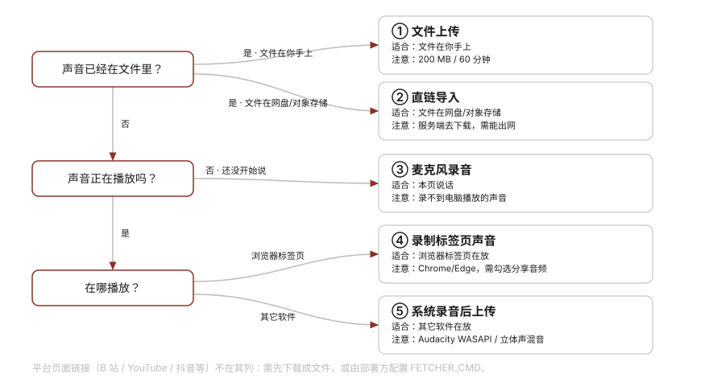

# 接入指南：别人怎么把本项目接进自己的系统

> 回答的问题：**"这个项目别人接进自己系统，怎么做到、怎么接入？"**
> 对应规格：`需求规格.md` US-8/9/10、`决策记录.md` **D-019**
> 核心设计判断：**只做两个接入面（REST API + Webhook），其余一律是派生**。不写插件生态。

---

## 一、为什么不给每家写一个集成

如果再写"飞书插件 / Obsidian 插件 / VS Code 插件 / Chrome 扩展"，会同时违反两条原则：

- 宪法原则 IV（时间盒）：每加一个集成都是无底洞；
- D-015 / D-030：5 周也要守住范围，做不完就得砍。

**正确做法**：暴露最小、稳定、标准的两个面，让用户的自动化工具（n8n / Zapier / 自己写的脚本 / AI agent）去长出来。
这也是成熟自托管项目的通用做法（Nextcloud、Immich 都是先有 API + Webhook，社区再长出客户端）。

---

## 二、四个接入面（按优先级）

| # | 接入面 | 谁用 | 优先级 |
|---|---|---|---|
| 1 | **REST API**（`POST /api/v1/tasks` 等） | 任何能发 HTTP 的系统：脚本、后端服务、自动化平台 | **P1** |
| 2 | **Webhook 回调**（完成/失败时主动 POST 到你的 URL） | 不想轮询的系统：n8n、群机器人、issue 系统 | **P1** |
| 3 | **OpenAPI / Swagger 规范**（`/v3/api-docs`） | 用来自动生成客户端、Postman 导入、AI agent 读契约 | **P1**（✅ T4.6 已实现：`/v3/api-docs` + `/swagger-ui/index.html`，匿名可访问，声明 `bearer`） |
| 4 | **inbox 目录监控**（宿主目录放文件即处理） | NAS / Obsidian / 不会写代码的用户 | P2 |
| 5 | **导出直链**（Markdown / JSON 下载） | 只要结果不要流程的人 | P2 |
| 6 | **MCP server**（让 AI agent 直接调"转写并取纪要"） | 2026 年出现的接入方式，可选加分 | P3 |

> **不做的接入面**：数据库直连（强耦合）、私有 RPC 协议（换语言就废）、为每家客户端写 SDK。

---

## 三、REST API 契约（v1 最小集）

统一前缀 `/api/v1`，鉴权 `Authorization: Bearer <凭据>`——**T4.6 起已强制**：缺/错凭据一律 `401 {"code":"UNAUTHORIZED",…}` +
响应头 `WWW-Authenticate: Bearer`；**豁免面**：静态页面与资源、`/v3/api-docs`、`/swagger-ui`（契约发现不需要 token）。
**T4.89/P-28 起 `/actuator/**` 不再豁免**：health/prometheus/metrics/info 均需 Bearer；容器内 healthcheck 用容器内 `$API_TOKEN` 探测，外部匿名探测会 401。

**两种凭据（T4.37a 起，等价双轨）**：
- `Bearer <API_TOKEN>` = **1 号账号（管理员）**——既有接入**零改动**，全部历史任务归它；
- `Bearer <账号令牌>` = 具体账号——由 `POST /api/v1/auth/login|register` 签发（见 §3.12），数据按用户隔离；
- 任一凭据不匹配 → 401，两种凭据可**混用切换**（同一客户端逐请求选择）。

`API_TOKEN` 为空串时**拒绝所有 API 请求**（fail-closed，不是放行）；请在 `.env` 里改掉默认值 `change-me-api-token`。
**浏览器页面**统一走登录页（T4.37b 已实装，`login.html`）：账号密码登录/注册，401 自动回登录页；`API_TOKEN` 只用于外部接入，浏览器不再粘贴 token。

| 方法 | 路径 | 作用 |
|---|---|---|
| `POST` | `/api/v1/tasks` | 提交任务（multipart 上传音频/字幕 **或** JSON 文本） |
| `POST` | `/api/v1/tasks/batch` | **批量提交**（同名 `files` part 重复，≤20 个；200 + 逐项结果，T4.7） |
| `GET` | `/api/v1/tasks/{id}` | 查状态（PENDING/RUNNING/DONE/RETRYING/DEAD） |
| `GET` | `/api/v1/tasks/{id}` | 查状态 + 取结果（DONE 时 transcript/summary/todos/keywords 一次给全；独立 `/result` 端点 **决定不拆**，见 D-085） |
| `GET` | `/api/v1/tasks/{id}/export?format=md` | 导出 Markdown（摘要/关键词/待办，T3.7） |
| `GET` | `/api/v1/tasks` | 列表查询（keyset 分页 + `status` 过滤，T2.10） |
| `POST` | `/api/v1/tasks/retry` | **批量重试**（只复活 DEAD；**复活重新计入配额**，T4.87；额度不足 429 且任务保持 DEAD） |
| `DELETE` | `/api/v1/tasks/{id}` | **删除单个任务（T4.96 起进回收站，软删除）**（仅 DONE/DEAD 可删；进行中 409 TASK_BUSY；保留期内可恢复；**配额不退**，D-115/D-245） |
| `POST` | `/api/v1/tasks/delete` | **批量删除**（body `{"ids":[…]}`，1..100 条去重，逐条结果不整体失败；**删除不退配额**，T4.21） |
| `POST` | `/api/v1/tasks/delete-failed` | **清空失败任务**（当前用户全部未在回收站的 DEAD 进回收站；RETRYING 不算失败不删；**配额不退**，T4.21/T4.96） |
| `GET` | `/api/v1/glossary` | 术语表只读列表（T4.1，设置页用） |
| `GET` | `/api/v1/settings` | 只读：今日配额 + 当前 AI 首选档位（T4.1） |
| `GET` | `/api/v1/quota` | 只读：今日配额 + 显式策略 `policy`（T4.87） |

**配额策略（T4.87 / 审计 P-31）**：创建任务扣 `ceil(duration/60)` 分钟 + 1 次（PASTE 为 0 分钟）。
**终局失败（DEAD）自动退还分钟数、次数不退**（失败不该按分钟收费；次数是尝试预算，退次数会变成无限刷）；
退款落到**任务创建日**（`created_at::date`），`used_minutes` 用 `GREATEST(0, …)` 不为负；`task.quota_refunded`
与 `status='DEAD'` 同真同假，重复退款幂等只生效一次。**删除任务（DONE/DEAD）不退**（D-115，用户主动放弃）。
**复活/重试（离开 DEAD）重新扣一次分钟 + 1 次**（与重新提交等价，堵「失败退款=免费重试」漏洞）；额度不足抛
429 `QUOTA_EXCEEDED` 且事务回滚、任务保持 DEAD/`quota_refunded=true`。机器可读策略见 `GET /api/v1/quota` 的
`policy`：`{"delete_refunds":false,"failure_refunds":"minutes_only","retry_consumes":true}`。

### 3.1 提交任务

音频（multipart）：

```http
POST /api/v1/tasks
Authorization: Bearer <API_TOKEN>
Content-Type: multipart/form-data

file=@会议.mp3
template=course                                    ← 可选：摘要模板（缺省 → 按文件名自动推荐 → meeting）
language=en                                        ← 可选（T4.99）：2–3 位小写语言码（zh/en/ja/yue…）或 auto；缺省 = 部署级 ASR_LANGUAGE（默认 zh）
callback_url=https://你的系统/hooks/meeting-done   ← 可选，覆盖全局 WEBHOOK_URL
```

**language（T4.99）**：三个建任务入口（上传 multipart / 链接导入 JSON / 粘贴文本 JSON）都接受可选 `language` 字段：
- 合法值：2–3 位小写语言码（如 `zh`、`en`、`ja`、`yue`）或 `auto`（faster-whisper 自动检测）；
- 非法值 → `400 INVALID_PARAM`，message 逐字：`language 只支持 2–3 位小写语言码（如 zh、en、ja），或 auto`；
- **缺省 / 空白 = 不传**，走部署级 `ASR_LANGUAGE`（默认 zh）——与 T4.99 之前的客户端行为完全一致；
- 英文等外语内容建议显式传 `language=en`（或 `auto`），否则会按部署级中文解码出乱串。

**浏览器录音（T4.30/T4.30b）**：前端「浏览器录音」用 MediaRecorder 产出 webm/opus 直接走本端点上传（文件头识别、不看扩展名）；流式 webm 容器头部无时长，时长由 ffprobe 容器元数据兜底取末音频包 `pts_time(+duration_time)`，两路都拿不到才 400 `INVALID_MEDIA`。

**摘要模板（T3.9 / US-12）**：`template` 取值为封闭集合
`meeting`（默认，会议纪要）/ `course`（课程笔记：知识点/考点/复习）/ `interview`（访谈问答）/ `podcast`（Show notes）/ `shortvideo`（核心观点/论据/可执行动作/是否值得收藏）。
- 大小写不敏感、首尾空白忽略；**非法值 → 400 `INVALID_PARAM`**（message 逐字：`template 只支持 meeting/course/interview/podcast/shortvideo`），不静默回落；
- 不传时：**音频**按原文件名自动推荐（优先级 `shortvideo → course → interview → podcast → meeting`，命中即用；未命中默认 meeting）；
  **文本/字幕**不做文件名推荐，显式值否则 meeting；结果可追溯（`GET` 详情的 `template` + 服务端日志"模板：X（来源：显式/文件名/默认）"）；
- **注意（F-17）**：`content_hash` 不含模板——同一内容换模板重复提交会 `reused:true` 返回**原任务**（原模板），不会新建；"换模板重跑"属后续里程碑。

字幕（multipart，跳过转写；后缀 `.srt` / `.ass`，大小写不敏感；≤5MB → 超限 413）：
**解析不出任何文本 → 400 `INVALID_PARAM`（"字幕文件没有可识别文本"）；编码 UTF-8（含 BOM）→ GBK 兜底 → 都失败 400。**

```http
file=@会议.srt
template=interview        ← 可选（同上；字幕不自动推荐）
```

> **字幕解析的边界（F-16，已定案不修，写清文档）**：
> ①**编码只认 UTF-8（含 BOM）与 GBK**，其他编码（如 Big5/Shift-JIS）会按 UTF-8/GBK 乱码读取或 400，请先转码；
> ②**纯数字/纯符号的台词行会被丢弃**（解析器按"文本行"过滤），台词本身只有数字时可能得到"没有可识别文本"→ 400；
> ③只处理 UTF-8/GBK 的 `.srt`/`.ass` 文本格式，**二进制字幕（.sub/.idx、.sup）不支持**。

文本（JSON，跳过转写；`text` trim 后 1..100_000 字符；`Content-Type: application/json`，其他类型 → 415）：

```json
POST /api/v1/tasks
{ "text": "……会议记录/字幕文本……", "template": "podcast", "language": "auto" }
```

- **直链导入（T4.32a）已实装**：独立端点 `POST /api/v1/tasks/link`（见 §3.9）；`callback_url` 属后续里程碑；
- **音频与文本/字幕幂等口径一致**：`content_hash` 是"内容哈希"（音频=文件字节；文本/字幕=解析后文本 UTF-8 字节），
  同内容重复提交 → 201 + `reused:true` + 原 `task_id`，**不重复入列、不重复扣配额**；
- **文本/字幕任务是"秒出"**：worker 直接读文本 → 结构化 → DONE（不调 ASR/ffmpeg）。

**响应**（同步返回，不在 HTTP 里等转写完成）：

```json
{ "task_id": 123, "status": "PENDING", "content_hash": "9f2c…",
  "duration_sec": 237, "size_bytes": 7559718, "reused": false }
```

- **`duration_sec` 可为 `null`**：音频/视频任务是时长（秒）；PASTE/字幕任务没有音频时长 → `null`（键恒在，不要当错误）；
  `size_bytes` 对文本/字幕是最终文本的 UTF-8 字节数。
- `reused: true` → 命中了已有任务（N1/N10），**不重复入列、不重复消耗算力与配额**，`status` 是那条任务的**真实状态**
  （可能已经是 `DONE`，接入方拿到后应先查 `GET /api/v1/tasks/{id}` 再决定要不要等）；
- 幂等：同一内容重复提交返回同一 `task_id`（N1，T2.1 起靠 `content_hash` 唯一约束兜底并发）；
- **字段命名一律 snake_case**（全项目统一，含 webhook 契约）；错误响应统一 `{"code": "...", "message": "..."}`。
  见 D-041。

### 3.2 查结果

> **当前实现**：用 `GET /api/v1/tasks/{id}` 一次拿到"状态 + 全部结果"。
> 独立端点 `GET /api/v1/tasks/{id}/result` **决定不拆**（D-085：v1 少一次往返；DONE 后一次拿全已够用）。
> **前端交互（T4.38 起）**：列表/首页的「详情」支持**站内右侧抽屉**打开（iframe 复用 `task.html?id=`，不新开浏览器标签，ESC/点遮罩关闭）；
> `task.html?id=X` **深链保持不变**，抽屉头也提供「新标签打开 / 复制链接」。

```json
GET /api/v1/tasks/123
→ {
  "task_id": 123,
  "status": "DONE",
  "duration_sec": 237,
  "size_bytes": 7559718,
  "created_at": "2026-11-14T15:18:38+08:00",
  "transcript": "……全文……",
  "error_code": null,
  "summary": "……摘要……",
  "keywords": ["线性代数", "矩阵"],
  "ai_tier": "CLOUD",                    ← CLOUD / LOCAL / EXTRACTIVE（D-020；T3.3 起三档都可能出现）
  "todos": [ { "action": "整理第三章笔记", "owner": "我", "deadline": "2026-11-20", "done": false } ],
  "keypoints": [ { "title": "第三章要点", "detail": "矩阵乘法与线性变换的对应关系。" } ],  ← T4.17 第 14 键
  "transcript_punctuated": "……带标点的转写全文（旧任务/无标点数据为 null）……",  ← T4.18 第 13 键
  "template": "course",                  ← T3.9 第 12 键：meeting/course/interview/podcast/shortvideo；T3.9 前旧任务为 null
  "segments": [                          ← T4.35a 第 15 键：句子级时间戳（播放器点句跳转用，T4.35b/c）
    { "start": 0.12, "end": 3.45, "text": "大家好，我们开始。" },
    { "start": 3.5,  "end": 9.4,  "text": "今天讲第三章。" }
  ],
  "speaker_map": { "0": "说话人 1", "1": "说话人 2" },  ← T4.36 第 16 键：手工标注的句子下标→说话人；未标注/清除/旧任务为 null（不是 {}）
  "display_name": "第三章 讲座"          ← T4.43 第 17 键：用户展示名；未命名/清除/旧任务为 null（不是 ""）
}
```

- `duration_sec` 对 PASTE/字幕任务为 `null`（无音频时长），其余同 §3.1。
- **详情键集（只增不改）**：T3.9 的 12 键 + `transcript_punctuated`（T4.18 第 13）+ `keypoints`（T4.17 第 14）
  + `segments`（T4.35a 第 15）+ `speaker_map`（T4.36 第 16）+ `display_name`（T4.43 第 17）：
  `task_id / status / duration_sec / size_bytes / created_at / transcript / error_code / summary / keywords / ai_tier / todos / keypoints / transcript_punctuated / template / segments / speaker_map / display_name`；
  `template` 为本次实际使用的摘要模板（可追溯，US-12 要求），旧任务 `null`。
  `speaker_map`：手工说话人标注，**键=句子下标字符串、值=标签（1–20 字符）**；未标注/清除/旧任务为 `null`（不是 `{}`）。
  `display_name`：用户自定义展示名（重命名见 §3.13），原文件名（对象存储 key）**不改、不丢**（溯源不动）。
- **`segments`（T4.35a，句子级时间戳）**：元素固定 `{start, end, text}`——`start`/`end` 为秒（小数），
  `text` 为该句文本（去首尾空白）。**null ≠ []（别混）**：
  - `null` = 本任务没有句子级时间戳：**改造前的历史任务**（迁移不回填）与 **PASTE/字幕文本任务**（无音频）；
    前端据此隐藏播放器（T4.35c）；
  - `[]` = 空音频（有响应无内容，如纯静音）；
  - 非空数组 = 正常句子级时间戳；与 `transcript` 同一次 ASR 调用产生（不二次调 ASR），随 DONE 一起就绪（D-069）。

- `status` 取值：`PENDING`（已接收未开始）/ `RUNNING`（转写中）/ `DONE`（完成）/ `RETRYING`（**等待下次重试**，
  T4.100：失败后按指数退避等待，不占 worker；前端仍显示「进行中」）/ `DEAD`（重试耗尽，进死信）。
  `RETRYING` 期间**不要**当失败处理，继续按 3 秒轮询。退避时间 `next_retry_at` 是**内部调度字段，
  不对客户端暴露**（不在任何 API 响应里）；接入方只需按状态轮询，无需也不应解析该字段。
  **进程崩溃也计入 attempts**（T4.94）：worker 被 SIGKILL/OOM 后，恢复路径同样把该任务 `attempts + 1` 重投，
  达到 `TASK_MAX_RETRIES`（默认 3）进 `DEAD` 并退分钟数。
- **`DONE` = 结果已全部就绪**（D-069/T3.2）：`summary`（若可生成）、`todos`、`keywords` 在 `DONE` 那一刻已经写好，
  **不会出现"先 DONE、几秒后才有摘要"**。所以看到 `DONE` 就可以直接落库/推送，不需要二次确认。
- **`transcript: ""`（空串）是正常业务结果**——表示这段音频里没有可识别的人声（纯音乐/静音/无人声），
  任务仍是 `DONE`、不算失败。界面应提示「未识别到语音内容」，不要显示成错误（D-048）。
  此时 `summary`/`todos`/`ai_tier` 均为 `null`（没有可结构化的内容，不去编）。
- 未完成时 `transcript` 为 `null`；`null` 和 `""` 含义不同，别混。
- **`todos`（T3.2/T3.5，D-072）**：字段**恒在**。`null` = 本次没生成（没配 AI/调用失败/解析失败/空 transcript）；
  `[]` = AI 明确判断"没有待办"；数组元素固定 `{action, owner, deadline, done}`（`done` 缺省按 `false` 读），
  **`owner`/`deadline` 未知就是 `null`，系统不会猜**。想区分"AI 失败"和"确实没待办"，看 `null` vs `[]`。
- **改词回流 + 待办操作（T3.5，供"结果可修正"的接入方）**（写操作都在 `user_id` 维度鉴权）：
  ```http
  POST   /api/v1/tasks/{id}/corrections      {"corrections":[{"wrong":"工作副盘","right":"工作复盘"}]}
  PATCH  /api/v1/tasks/{id}/todos/{index}    {"done": true}
  DELETE /api/v1/tasks/{id}/todos/{index}
  ```
  改词会同时替换本任务 transcript/summary/keywords/todos 里的错词，并沉淀到 glossary（下次转写注入，T3.6）；待办 `PATCH` 幂等，
  `DELETE` 非幂等（删除后 index 前移）。
- **`ai_tier`（T3.3 起）**：`CLOUD` 云 API / `LOCAL` 本地 ollama / `EXTRACTIVE` 零依赖抽取式——
  用户有权知道这次的质量档位；**档位不虚标**（抽取式绝不标成 CLOUD）。
- **DONE 前的最坏等待（F-7）**：结构化是**同步**做的（D-068），AI 这两步最坏各 120s 超时（合计 ≤240s，
  三档合并成一次调用后 ≤120s）。轮询建议：3 秒一次、**至少容忍 5 分钟**再判超时；`RUNNING` 停留较久是正常的。
- **`GET /api/v1/tasks/{id}` 响应含 `error_code`（T1.6 S-3，只增不改）**：仅 `RETRYING`/`DEAD` 时有值
  （稳定错误码，如 `ASR_ERROR`；worker 侧子集见 §3.3），其余状态为 `null`。
- **`dead_letter` 的 `reason`（T4.99 起脱敏）**：页面上「为什么失败」展示的人话文案已**不含内部地址、容器名或异常原文**；完整异常与堆栈只在服务端日志（`docker logs app`）里，排障不受影响。
- **失败可视字段（T4.95，只增不改）**：详情响应末尾增 `error_message`（人话失败原因，取
  `dead_letter` 最新一条 `reason`；DEAD 有值，RETRYING 通常为 null——那时还没死、无死信行）
  与 `attempts`（已尝试次数，非负整数，失败/崩溃每次 +1）；列表响应末尾增 `error_message`（同源子查询）。
  两字段**仅 `DEAD`/`RETRYING` 有意义，其余状态为 null/0**；后端不按状态裁剪（DONE 可能残留历史
  死信行，T4.87 复活后残留），展示判断归前端。错误码 → 人话映射见页面「为什么失败」块；未知码原样显示不编造。
- **ASR 不可用时的时延（T2.2/D-058 + T4.100 退避）**：任务大约 **3–7 秒**内进入 `RETRYING`（connect 超时 5s，
  写超时 900s 只为长音频不误杀）。T4.100 起失败**不再立即重投**：按 `RETRY_BASE_DELAY_SEC`（默认 30）起指数退避，
  依次为 30s/60s/120s（封顶 `RETRY_MAX_DELAY_SEC` 默认 300s），3 次尝试耗尽才进 `DEAD`——容器在分钟级恢复时任务能
  自己救回来，不再「10 秒烧完」。接入方轮询看到 `RETRYING` 时按退避继续等，看到 `DEAD` 时换文件或重传触发复活。

### 3.3 列表查询（T2.10 / D-053）

```json
GET /api/v1/tasks?status=DONE&limit=20&before_id=123
→ {
  "items": [
    { "id": 123, "status": "DONE", "original_name": "第三章讲座.wav",
      "duration_sec": 237, "created_at": "2026-11-14T03:54:56.97Z", "error_code": null }
  ],
  "next_before_id": 121,
  "total": 299
}
```

- **按 `id` 倒序**（最新在前）；`limit` 默认 **20**、上限 **50**；`next_before_id: null` = 没有更多。
- **翻页用 keyset，没有 offset**：把 `next_before_id` 原样作为下一次请求的 `before_id`，**不重不漏**。
- `status` 可空，取值同 §3.2 的五个状态（大小写敏感）。
- **`q` 可选（T4.24，服务端搜索，只增）**：按文件名（对象存储 key）模糊匹配，大小写不敏感；
  首尾去空格，空白 = 不筛选；最长 **100** 字符，超长 → **400 `INVALID_PARAM`**；
  `%` / `_` / `\` 按字面匹配（服务端已转义，接入方无需自己转义）；`q` 为纯数字时额外**精确匹配任务 id**（**超出 64 位整数范围的数字按普通关键词处理**，T4.24b）。
- **`label` / `favorite` 可选（T4.29，只增；T4.42 扩展）**：`label=<标签>` 按标签筛选（jsonb 包含匹配、值参数化）；
  **`label` 支持多值（T4.42，D-162）**：重复 `label` 参数（`label=会议&label=课程`）= **OR 并集**（含任一选中标签即命中）——
  **同一筛选维度内多值取并集、跨维度取交集**（筛选栏通行心智）；单标签行为不变。全程参数化（每标签一个 `@>` 条件，OR 括号组）。
  `favorite=true|false` 按收藏筛选（其它值 → `400 INVALID_PARAM`）。两者与 `status`/`q`/`before_id` 可组合，分页语义不变。
- **`created_after` / `created_before` 可选（T4.42，只增）**：`YYYY-MM-DD`（ISO 严格格式，`2026-1-1` 这类宽松写法 → 400），
  按服务端时区解释为**半开区间**：`after` = 当日 00:00 起、`before` = **次日** 00:00 止（`before=after` 同一天合法，含当天全天）；
  格式非法或 `after` 晚于 `before` → **400 `INVALID_PARAM`**。只给一端合法。与 `status`/`q`/`label`/`favorite`/`before_id` 任意组合，分页语义不变。
- **`total` 响应键（T4.42，只增，键不省略）**：同筛选条件的总条数（COUNT，**不含 `before_id` 游标与分页**），
  位于响应末尾——前端「共 N 条 · 已加载 M 条」即用它。
- **不做自定义排序**：排序固定 `id DESC`（keyset 游标与 sort 冲突；如需另卡）。
- 列表项 **只增** 两字段：`labels`（jsonb 字符串数组，坏数据 → `[]`）、`favorite`（布尔）。
  与 `status` / `before_id` 可组合，分页与排序语义不变。
- **`display_name`（T4.43，只增在末尾）**：用户展示名（重命名见 §3.13）；未命名/清除/旧任务为 `null`
  （**键不省略**，null 也返回）；原文件名 `original_name` 口径不变（溯源不动）。
- `original_name` 是展示用文件名（从对象存储路径解析；`PASTE`/链接类任务可能不是"上传文件名"）。
- `error_code` 语义同 §3.2（只有 `RETRYING`/`DEAD` 有值）。
- 参数非法（`status` 不在五个值内、`limit`/`before_id` 非数字或越界、`q` 超长）→ **400 `INVALID_PARAM`**（T2.12 收口，不再返回空列表）。

### 3.3a 状态计数（T4.24，只增端点）

```json
GET /api/v1/tasks/counts
→ { "total": 42, "active": 3, "done": 36, "dead": 3 }
```

- 当前用户任务的**真计数**（服务端 GROUP BY，无上限；取代"客户端逐页累加、上限 200"的近似口径）。
- 键集固定四键：`total` 全部；`active` = `PENDING`+`RUNNING`+`RETRYING` 合计；`done` = `DONE`；`dead` = `DEAD`。
- 无参数、无分页；响应结构只增不改。

### 3.3b 使用统计（T4.25，只增端点）

```json
GET /api/v1/stats
→ {
  "tasks": { "total": 42, "active": 3, "done": 36, "dead": 3 },
  "duration_sec_total": 123456,
  "success_rate": 0.923,
  "avg_processing_ratio": 1.87,
  "tiers": { "CLOUD": 30, "LOCAL": 4, "EXTRACTIVE": 1, "null": 1 }
}
```

- 当前用户只读聚合，无参数、无分页；**键集固定五键**（`success_rate` / `avg_processing_ratio` 无数据时为 `null`，键不省略）。
- `tasks`：与 §3.3a `/tasks/counts` 同口径（同一个 GROUP BY 语义）。
- `duration_sec_total`：全部任务媒体时长（秒）合计；PASTE 等无时长任务不计入。
- `success_rate` = `done/(done+dead)`，保留 3 位小数；分母 0（没有任何 DONE/DEAD 任务）→ `null`。
- `avg_processing_ratio`：**平均处理倍速（含排队，近似值）**——只统计 `DONE` 且 `duration_sec>0` 的任务，
  = `AVG(EXTRACT(EPOCH FROM (updated_at-created_at)) / NULLIF(duration_sec,0))`；**不是 RTF**（含排队等待）；
  无数据 → `null`。
- `tiers`：`DONE` 任务按 `task_result.ai_tier` 分组；`null`（AI 未启用/旧任务）单列 `"null"` 键；无 DONE 任务 → `{}`。

### 3.4 错误码（必须固定，否则接入方无法处理）

| HTTP | code | 含义 | 接入方该怎么做 |
|---|---|---|---|
| 400 | `INVALID_MEDIA` | 文件头/格式不合法（N6） | 不要重试，换文件 |
| 413 | `SIZE_EXCEEDED` | 超过大小上限 | 不要重试，切分文件 |
| 400 | `DURATION_EXCEEDED` | 超过时长上限 | 不要重试，切分文件 |
| 400 | `URL_BLOCKED` | SSRF 拦截（N7）；T4.32a 起实装于 `POST /tasks/link`（含每跳重定向校验） | 不要重试 |
| 400 | `NOT_DIRECT_MEDIA` | **T4.32a** 链接导入：目标是网页（text/html）而非音/视频直链 | 把页面里的媒体导出成文件后上传 |
| 502 | `FETCH_FAILED` | **T4.32a** 链接导入：域名解析失败/超时/远端非 2xx | 检查链接可达性后重试 |
| 401 | `UNAUTHORIZED` | token 错 | 修配置 |
| 409 | `USERNAME_TAKEN` | **T4.37a** 注册：用户名已存在（大小写不敏感） | 换用户名 |
| 401 | `INVALID_CREDENTIALS` | **T4.37a** 登录：用户名或密码错误（不区分"用户不存在"） | 修凭据，不要重试超过必要次数 |
| 403 | `REGISTRATION_DISABLED` | **T4.37a** 注册：`AUTH_REGISTRATION_ENABLED=false`（1 号账号认领不受限） | 联系管理员 |
| 404 | `TASK_NOT_FOUND` | 任务不存在（或不属于当前 token 的用户，对外不区分） | 不要重试，核对 `task_id` |
| 429 | `QUOTA_EXCEEDED` / `TOO_MANY_REQUESTS` | 配额/限流（N8）；配额用尽；失败任务已自动退还分钟数（T4.87） | **按 `Retry-After` 退避重试** |
| 503 | `ASR_UNAVAILABLE` | ASR 不可用 | 退避重试 |
| 503 | `QUEUE_UNAVAILABLE` | **T4.50** 任务队列（Redis）不可用：任务行已落库但仍 `PENDING`，不会自动重试 | **同请求重发即自愈**（幂等命中会重新入队）；`Retry-After` 暂未返回，建议 5–30s 退避重试 |

**码表只增不改**（增删改都是破坏性变更，要发版说明）。**业务码（T4.50 起 14 个）**：上面 8 类 + `TASK_NOT_FOUND`（D-047）+ `FETCHER_UNAVAILABLE`（T4.32b）+ `USERNAME_TAKEN`/`INVALID_CREDENTIALS`/`REGISTRATION_DISABLED`（T4.37a；其中 `URL_BLOCKED` 自 N7 预留转实装，`NOT_DIRECT_MEDIA`/`FETCH_FAILED` 为 T4.32a 新增）。

**通用码（非业务，D-057）**：参数/框架类错误单独一层，接入方一般按"改请求"处理，不要重试：

| HTTP | code | 含义 |
|---|---|---|
| 400 | `INVALID_PARAM` | 请求参数不合法（`limit` 越界/非数字、`status` 非法值、`text` 空/超长、`format` 非 `md`、路径参数类型错等） |
| 404 | `NOT_FOUND` | 路径/资源不存在（任务级仍是 `TASK_NOT_FOUND`） |
| 405 | `METHOD_NOT_ALLOWED` | 请求方法不支持 |
| 415 | `UNSUPPORTED_MEDIA_TYPE` | `Content-Type` 不支持（音频/字幕走 `multipart/form-data`，文本走 `application/json`） |
| 500 | `INTERNAL_ERROR` | 未捕获异常兜底（响应体不含堆栈/内部细节） |

**DEAD 任务重传 = 复活**（T2.1 起，D-049/D-055）：同一文件再次 `POST /api/v1/tasks` 时，若命中的任务处于 `DEAD`，
服务端会**重置该任务**（`attempts=0`、`status=PENDING`、`error_code=null`）并重新入队，响应为
`{"reused": true, "status": "PENDING", "task_id": <原 id>, ...}`——**不新建任务、不重复扣配额**。
接入方据此判断：`reused:true` + `status:PENDING` = 已复活，继续轮询原 `task_id` 即可。

### 3.5 导出 Markdown（T3.7）

```http
GET /api/v1/tasks/123/export?format=md
Authorization: Bearer <API_TOKEN>
```

- `200`：`Content-Type: text/markdown; charset=utf-8`、`Content-Disposition: attachment; filename="task-123.md"`
  （**T4.43**：任务已命名时优先展示名——`filename`（ASCII 名）+ `filename*`（RFC 5987 UTF-8 编码）双写；
  无展示名维持 `task-<id>.md` 原口径）；
- 正文三节**固定顺序**：`## 摘要` / `## 关键词`（逗号分隔）/ `## 待办`（`- [x]` 已完成、`- [ ]` 未完成，
  有 owner/deadline 才追加 `（owner: X / deadline: Y）`）；某节无内容写 `（无）`；
- **不建任务、不耗配额**；`format` 缺失或非 `md` → `400 INVALID_PARAM`；任务不存在/非本人 → `404 TASK_NOT_FOUND`；
  任务未 `DONE` 或 transcript 为空 → `400 INVALID_PARAM`（"任务没有可导出的内容"）；
- 导出内容只含摘要/关键词/待办三节（不含全文；全文用 §3.2 详情）。批量导出/PDF 属后续里程碑。

### 3.5a 批量导出 zip（T4.27，只增端点）

```text
GET /api/v1/tasks/export?ids=1,2,3
→ 200 Content-Type: application/zip
     Content-Disposition: attachment; filename="meeting-notes-<yyyyMMdd-HHmm>.zip"
```

- `ids` 逗号分隔任务 id，**≤20 个**（去重保序）；缺失/空/含非数字/超 20 → `400 INVALID_PARAM`。
- zip 内每个任务一个 `<id>-<安全文件名>.md`（**T4.43**：优先展示名——非法字符 `/ \ : * ? " < > |` 替换 `_`、
  限长 80、空则回退；无展示名取对象存储 key 尾段、去扩展名、非法字符替换 `_`，原口径不变），
  内容与单条导出（默认导出摘要、关键词、要点、转写、待办五节，T4.102 起默认含待办；可用 `include` 只挑部分）**逐字节一致**（同一渲染器）。
- **流式**打包（`StreamingResponseBody` + `ZipOutputStream`），服务端不把整个 zip 读进内存。
- 不存在/非本人/非 DONE/transcript 空 → 该条**跳过**，zip 内附 `_errors.txt`（每行 `task_id: 原因`，
  原因 ∈ `NOT_FOUND`/`NO_CONTENT`）；全部跳过 → `400 INVALID_PARAM`（不会返回空 zip）。
- 无 token → `401`。改单条导出契约的部分（路径/include/format）不受影响。

### 3.6a 任务删除（T4.21 / D-115）

三个端点共同口径：**删除后不可恢复，已用配额不退还**；事务内同删 task / task_result / dead_letter / webhook_delivery；MinIO 对象 best-effort 删除（失败只记日志，不影响 DB 行删除）。仅 DONE/DEAD 可删；PENDING/RUNNING/RETRYING → `409 TASK_BUSY`（新错误码）；不存在/非本人 → `404 TASK_NOT_FOUND`。

```json
DELETE /api/v1/tasks/{id}
→ 200 { "deleted": 1 }

POST /api/v1/tasks/delete
{ "ids": [3, 4, 3, 99] }
→ 200 {
  "results": [
    { "id": 3, "deleted": true, "reason": null },
    { "id": 4, "deleted": false, "reason": "TASK_BUSY" },
    { "id": 99, "deleted": false, "reason": "NOT_FOUND" }
  ]
}
```

- 批量：1..100 条、重复 id 去重、**逐条结果不整体失败**（口径同批量重试）。
- 清空失败任务：`POST /api/v1/tasks/delete-failed`（body 空 JSON `{}`）→ `{"deleted": N}`，把当前用户全部未在回收站的 `status='DEAD'` 任务**送进回收站**（不限已加载行；RETRYING 不算失败、不删；T4.96 起为软删除）。

### 3.x 回收站（T4.96，v0.2 / D-245）

删除 = **软删除**（`task.deleted_at` 置时间戳，转写/纪要/标签/收藏/死信原因/原音频全部保留），保留期
`TRASH_RETENTION_DAYS`（默认 30 天）内可恢复，到期由清扫器物理删除。**配额删除/恢复/彻底删除都不退不扣**（D-115）。

| 方法 | 路径 | 说明 |
|---|---|---|
| `GET` | `/api/v1/tasks?trash=true` | 回收站列表（响应增 `deleted_at` / `days_left`，仅此模式有值） |
| `POST` | `/api/v1/tasks/{id}/restore` | 恢复（`{"restored":true}`；不在回收站/非本人 → 404 `TASK_NOT_FOUND`） |
| `POST` | `/api/v1/tasks/batch-restore` | 批量恢复（1..100 去重、逐条部分成功，`{"results":[{"id","restored","reason"}]}`） |
| `DELETE` | `/api/v1/tasks/{id}/purge` | **彻底删除**（物理删 4 表 + MinIO 对象；不在回收站 → 404；配额不退） |
| `POST` | `/api/v1/tasks/purge-all` | 清空当前用户回收站（`{"purged":N}`） |

**回收站任务对外不可见**：默认列表/详情（404 `TASK_NOT_FOUND`）/分享链接（匿名 404 `SHARE_NOT_FOUND`）/
批量重试（逐条 skipped `NOT_FOUND`）/改名·改词·待办变更（404）一概排除；webhook 不再投递（日志 `reason=TRASHED`）。
**幂等自动恢复**（D-245）：同一文件再次上传/链接导入命中回收站任务 → 自动恢复并复用同一 `task_id`（`reused=true`）。

### 3.6c 按模板重新生成（T4.26 / F-17，只增端点）

```json
POST /api/v1/tasks/{id}/restructure
{ "template": "course" }
→ 200 { "task_id": 123, "template": "course", "ai_tier": "CLOUD" }
```

- **只重跑结构化**（摘要/关键词/待办/要点/ai_tier/template）：不重跑 ASR、不新建任务、**不扣任务配额**；
  只用该任务已保存的 transcript。
- `template` 必填，5 选 1（`meeting/course/interview/podcast/shortvideo`，大小写不敏感，服务端规范化）；
  缺失/空白 → `400 INVALID_PARAM`（"template 必填"）；非法值 → `400 INVALID_PARAM`（message 沿用 D-085 固定文案，不静默回落）。
- 任务不存在/非本人 → `404 TASK_NOT_FOUND`；非 `DONE`（PENDING/RUNNING/RETRYING）→ `409 TASK_BUSY`；
  transcript 空/空转写 → `400 INVALID_PARAM`（没有可重生成的转写）。
- **失败不写半截**：结构化失败（如降级链耗尽）→ `500 INTERNAL_ERROR`，事务回滚，旧摘要/关键词/待办/要点与旧模板原样保留。
- 并发：同一任务同时只允许一个重跑（DB 行锁 NOWAIT），第二个并发请求 → `409 TASK_BUSY`。
- `ai_tier` 落实际产出档位（可能与上次不同——例如本次降级到 EXTRACTIVE）。

### 3.6 批量重试 / 术语表 / 设置（T4.1）

**批量重试**（把失败任务重新排队，不重复扣配额）：

```json
POST /api/v1/tasks/retry
{ "ids": [139, 140, 999999] }
→ 200 {
  "retried": [139],
  "skipped": [ { "id": 140, "reason": "NOT_DEAD" }, { "id": 999999, "reason": "NOT_FOUND" } ]
}
```

- **只处理 `DEAD`**：复活口径与"重传同一内容触发复活"完全一致（`attempts` 归零、清死信、重新入队），**不消费配额**；
- 非 DEAD / 不存在 / 非本人 → 逐条进 `skipped`，**不整体失败**（`reason` 只有 `NOT_DEAD` / `NOT_FOUND`）；
- 入参 1..20 个、自动去重保序；空数组 / >20 / 非数字 → `400 INVALID_PARAM`；
- 重试后任务回 `PENDING`，按 §3.2 轮询即可。

**术语表（只读）**：`GET /api/v1/glossary` → `[{"wrong_text":"工作副盘","right_text":"工作复盘","hits":1,"priority":0}]`（按 hits 倒序，最多 100 条）。
词条来源是页面"修正转写"的改词回流；`summary/keywords/todos` 会自动应用（CLOUD/LOCAL 走提示词注入，EXTRACTIVE 走确定性替换，T4.1/F-15）。

**设置（只读）**：`GET /api/v1/settings` → 今日配额（已用/上限/剩余）+ 当前 AI 首选档位与三条件：

```json
{"quota":{"used_minutes":66,"minutes_limit":120,"used_tasks":12,"tasks_limit":50,
          "remaining_minutes":54,"remaining_tasks":38},
 "ai_tier":{"preferred":"CLOUD","cloud_configured":true,"offline_mode":false,"local_ready":false}}
```

> 口径与启动日志"结构化首选档判定"一致：云配置开且非离线 → `CLOUD`；否则本地可用 → `LOCAL`；否则 `EXTRACTIVE`。

### 3.6d 标签 / 收藏（T4.29 / D-137，只增端点）

```json
PATCH /api/v1/tasks/{id}/meta
{ "labels": ["课程", "重点"], "favorite": true }
→ 200 { "task_id": 123, "labels": ["课程", "重点"], "favorite": true }
```

- body 可只带一个键：`labels`（字符串数组，**≤10 个**、每个 trim 后 **1–20 字**、去重保序；非数组/超限/非字符串/空串 → `400 INVALID_PARAM`）、
  `favorite`（布尔；非布尔 → 400）；两键都缺 → 400。未提供的键保持原值（COALESCE）。
- 任务不存在/非本人 → `404 TASK_NOT_FOUND`。
- `GET /api/v1/tasks/{id}/meta` → 读回当前 `{task_id, labels, favorite}`（详情 14 键不动，这是独立只增端点）。
- 存储：`labels` 为 **jsonb 数组**（不用逗号拼字符串）；任务删除时随行删除。

### 3.7 批量提交（T4.7 / US-8）

```http
POST /api/v1/tasks/batch
Authorization: Bearer <API_TOKEN>
Content-Type: multipart/form-data

files=@会议1.mp3       ← 同名 part 可重复，最多 20 个
files=@会议2.mp3
template=meeting       ← 可选，应用到本批全部文件（默认按文件名推荐/meeting）
```

**响应：请求本身合法就一定 200 —— 但 200 不代表全部成功**（部分成功语义，D-095/K-48）：

```json
{
  "items": [
    {"file_name":"会议1.mp3","task_id":201,"status":"PENDING","reused":false},
    {"file_name":"坏文件.mp3","code":"INVALID_MEDIA","message":"文件头无法识别…"},
    {"file_name":"旧任务.mp3","task_id":150,"status":"DONE","reused":true}
  ],
  "summary": {"accepted":2,"reused":1,"failed":1,"total_duration_sec":181,"estimated_sec":31}
}
```

- **接入方必须逐项看 `items[]`**：有 `task_id` = 受理（按 §3.2 轮询即可）；有 `code` = 该项失败（码表见 §3.4，单项失败**不影响其它项**）。
- `summary.accepted` **含 reused**；`reused=true` 表示同内容命中已有任务（返回原 `task_id`，**不重复扣配额**）。
- `total_duration_sec` = 成功项里可探测音频时长之和（PASTE/字幕无时长则跳过）；`estimated_sec` 只是预估（`round(total×系数 + accepted×2)`），**不是承诺**。
- 限额：文件数 **>20 → 400 `INVALID_PARAM`**；0 文件 → 400；**请求总体积 >2GB → 413 `SIZE_EXCEEDED`**（单文件仍受 200MB 上限）。
- 幂等：同内容文件重复提交返回 `reused=true` 与原 `task_id`，不新建任务、不重复扣配额。
- 配额：逐项扣；某一项配额不足 → 该项 `429 QUOTA_EXCEEDED`，**其余项继续**（这一点单测覆盖，尚未在"配额耗尽"时实机验证，见 T4.7 验收报告 §6）。

---

### 3.8 只读分享链接（T4.28，只增端点）

```json
POST /api/v1/tasks/123/share        ← 需 Bearer；任务须 DONE
→ 200 {
  "task_id": 123,
  "token": "k9N038lFSTkhXahVBoWh_DXKVHEBm3CQGRMn1eqR0HU",
  "url": "/share.html?token=k9N038lFSTkhXahVBoWh_DXKVHEBm3CQGRMn1eqR0HU",
  "expires_at": "2026-11-24T11:18:28+08:00"
}

DELETE /api/v1/tasks/123/share      ← 需 Bearer；撤销该任务全部未撤销链接
→ 200 { "revoked": 1 }

GET /api/v1/share/k9N038…HU         ← 匿名可访问（不需要 Bearer）
→ 200 { "task_id":123, "original_name":"会议.mp3", "duration_sec":181,
        "created_at":"…", "summary":"…", "keywords":[...], "keypoints":[...],
        "todos":[...], "transcript":"…", "transcript_punctuated":"…",
        "ai_tier":"CLOUD", "template":"meeting",
        "display_name":"周三例会" }   ← T4.43 只增在末尾（13 键）：优先展示；未命名/旧任务 null（分享页标题回退 original_name）
```

- **token 安全**：服务端 32 字节 `SecureRandom` → base64url（43 字符），**数据库只存 SHA256 hex，明文只在创建响应里出现一次**；拖库拿不到可用 token。
- **有效期**：`SHARE_TTL_DAYS`（默认 7 天，消费方 `app.share.ttl-days`）。
- **只读范围**：匿名读者只能拿到令牌对应那**一条**任务的 12 键子集（无列表、无其它任务、无任何写能力；
  T4.43 起末尾只增 `display_name`）；`share.html` 只读页不链接内部页面、无编辑/删除/导出/重跑入口、不弹 token 对话框。
- **失效统一 404 `SHARE_NOT_FOUND`**（不存在/已撤销/已过期**不区分原因**，防探测）；任务删除时链接级联删除。
- **认证面收窄**（K-46）：`ApiTokenFilter` **只豁免 `/api/v1/share/` 这一条前缀**；其它 `/api/v1/**` 对匿名与分享 token 仍一律 401。
- 创建口径：任务不存在/非本人 → 404 `TASK_NOT_FOUND`；非 `DONE` → 400 `INVALID_PARAM`。

### 3.9 链接导入（T4.32a 直链 FETCH，只增端点）

贴一个可直接下载的 http(s) 音/视频**直链**就能建任务（下载后与上传同一条管线：魔数 → 时长（含 webm 兜底）→ 幂等 → 配额 → MinIO → worker）：

```http
POST /api/v1/tasks/link
Authorization: Bearer <API_TOKEN>
Content-Type: application/json

{ "url": "https://example.com/audio/meeting.mp3" }
```

**响应**（201，与上传同形）：

```json
{ "task_id": 456, "status": "PENDING", "content_hash": "9f2c…",
  "duration_sec": 237, "size_bytes": 7559718, "reused": false }
```

- 幂等口径与上传一致：**同一字节内容**重复提交（哪怕换了 URL）→ 201 + `reused:true` + 原 `task_id`，不重复扣配额；命中 `DEAD` 复活重投。
- 模板按 URL 文件名自动推荐（同上传规则）；解析不出文件名 → 默认 `meeting`。本端点暂不接受显式 `template` 参数（属 T4.32b 页面链接卡）。
- `source_type='LINK'`；worker 侧与上传音频完全同路。

**错误码（本端点专属，均固定码）**：

| HTTP | code | 触发 | 接入方该怎么做 |
|---|---|---|---|
| 400 | `URL_BLOCKED` | 非 http/https、host 缺失、带 userinfo、解析出的 IP 落在回环/私有/链路本地（含 169.254.169.254 云元数据）/组播/未指定/IPv6 ULA/IPv4 映射；重定向**每一跳**都重新校验，超 `FETCH_MAX_REDIRECTS`（默认 5）也回它 | 不要重试，换公网直链 |
| 400 | `NOT_DIRECT_MEDIA` | 远端 `Content-Type: text/html`（页面链接而非直链） | 把页面里的媒体**导出成文件后走 `POST /api/v1/tasks` 上传** |
| 413 | `SIZE_EXCEEDED` | 下载内容超过 `FETCH_MAX_BYTES`（默认 200MB） | 不要重试 |
| 502 | `FETCH_FAILED` | 域名解析失败 / 连接与读超时（`FETCH_CONNECT_TIMEOUT_MS`/`FETCH_READ_TIMEOUT_MS`）/ 远端返回非 2xx | 检查链接可达性后重试 |
| 400 | `INVALID_PARAM` | `url` 缺失或空白 | 改请求 |
| 400 | `FETCHER_UNAVAILABLE` | **T4.32b** `use_byof:true` 但服务端未配置 `FETCHER_CMD`（BYOF 未启用） | 把媒体导出成文件后走 `POST /api/v1/tasks` 上传，或联系管理员配置外部抓取工具 |

**安全口径（必须写清楚）**：
- 只发**匿名 GET**（不带 cookie / 鉴权头 / 伪造签名），只跟随 301/302/303/307/308 且**逐跳**做 SSRF 校验（防 302 跳内网）；
- IP 判定一律**按真正会连到的地址**判，不是字符串黑名单：
  - **十进制/八进制**数字字面量（`2130706433`、`0177.0.0.1`）由服务端按 inet_aton 语义自行规范化后再判（**不能交给运行时解析器**：JDK 21 出于安全把前导 0 按十进制解析，`0177.0.0.1` 会被它算成公网 `177.0.0.1` 而漏拦）；
  - `0x7f.0.0.1`、`127.1` 这类写法在 Java URI 阶段就被判为非法 host（返回 400 `URL_BLOCKED`，更早拒）；
  - 两种路径的**对外结果一致**：都返 400 `URL_BLOCKED`，均已真机反例验证。
- `FETCH_ALLOW_HOSTS`（默认**空**）：逗号分隔主机白名单，命中则**跳过内网 IP 拦截**——仅限自测/受信内网部署，生产必须留空（SSRF 防护会被绕过）。

**已知限制（如实写）**：DNS rebinding 存在 TOCTOU 窗口——校验时与实际连接时的两次解析可能结果不同（v1 不做连接后复核）；不做平台页面解析（yt-dlp 等按 D-027R 永不做，页面链接的三级处理见下方 T4.32b）；单次下载上限默认 200MB（同任务大小口径，由 `FETCH_MAX_BYTES` 单独控制）。

### 3.9a 链接预览 + BYOF（T4.32b，只增端点）

**链接预览**（先看"是这个视频吗？"确认卡，而不是直接 400）：

```http
POST /api/v1/link/preview
Authorization: Bearer <API_TOKEN>
Content-Type: application/json

{ "url": "https://example.com/some/page" }
```

**响应**（200）：

```json
{ "kind": "direct|page|unsupported", "final_url": "https://…（跟随重定向后的最终地址）",
  "content_type": "text/html", "title": "视频标题", "image": "https://…/cover.jpg",
  "duration_sec": 61, "byof_available": false, "reason": null }
```

- `kind` 分类（卡面逐字）：`audio/*`、`video/*`、`application/octet-stream` → `direct`（可直接 `POST /tasks/link` 建任务）；`text/html` → `page`（从 `<head>` 解析 og:title / og:image / og:video:duration，兼容 og:audio:duration 与 `itemprop="duration"`；无 og 回退 `<title>`；都没有 `title=null` 不报错）；其它 → `unsupported` + 可读 `reason`。
- `duration_sec` 支持两种格式：ISO 8601（`PT1M2S`）与纯秒数（`61`）；`image` 相对路径已按 `final_url` 补全为绝对地址。
- 安全与 `/tasks/link` **同一道 `UrlGuard`（复用，不另写）**：内网/回环/链路本地/云元数据 → 400 `URL_BLOCKED`；解析失败 → 502 `FETCH_FAILED`；匿名 GET、手动跟随重定向且**每跳重校**；只读响应体前 `FETCH_PREVIEW_MAX_BYTES`（默认 2MB），不整页进内存。

**BYOF（Bring Your Own Fetcher）**：`POST /api/v1/tasks/link` 请求体增可选 `"use_byof": true`（默认 false，**既有请求语义与错误码不变**）：

- 服务端按 `FETCHER_CMD`（默认**空 = 未配置**）启动外部抓取工具：按空格拆 argv、**不过 shell**（`ProcessBuilder`）；`{url}` 占位符必填且必须是**独立 argv 元素**（杜绝注入）；`{out}` 可选（无则从 stdout 流式落盘）；输出同样受 `FETCH_MAX_BYTES` 限制；超时（`FETCHER_TIMEOUT_MS`，默认 120s）/非 0 退出 → 502 `FETCH_FAILED`（文案带 stderr 末 200 字）。
- 未配置 `FETCHER_CMD` 时带 `use_byof:true` 的请求 → **400 `FETCHER_UNAVAILABLE`**（新码，码表只增）；入口 URL 仍先过 `UrlGuard`（BYOF 只是换了"怎么下载"，不换"允许下载哪"）。
- **责任边界（必须写清楚）**：仓库**不含任何平台解析器**（D-027R）：不集成 yt-dlp、不执行 JS、不开无头浏览器、不带登录态/cookie、不伪造签名。BYOF 由**使用者自装工具、自负合规责任**（含平台条款与版权）；服务端只提供命令执行通道与既有 SSRF/大小防护。

### 3.9b 怎么拿到音视频直链（操作指引，T4.104）



> 图：四种输入通道怎么选。下面按「拿直链」继续展开；其它三条通道见 README / 首页。

> 这一节写给「手上没有文件、只有一条链接」的人。判定口径只有一句话：**把这个链接贴到浏览器地址栏回车，能直接播放声音/画面就是直链**；如果打开的是一个网页（有播放器外壳、弹幕、评论区），那就是页面链接，走本节第三小节。

**① 四种常见拿法**

| 来源 | 怎么拿 |
|---|---|
| 网页里正在播的媒体 | 播放器画面上**右键 →「复制视频地址 / 复制音频地址」**；没有右键菜单就 F12 → **Network** → 过滤 `Media` → 播放后出现的那条请求 → 右键 `Copy → Copy link address` |
| 播客 / 播客平台 | 找它的 **RSS**，`<enclosure url="…">` 里的地址就是直链（多数播客页脚或「RSS」按钮可见） |
| 网盘 / 对象存储（S3、MinIO、OSS） | 用「直下链接」/「预签名 URL」；注意签名链接会过期（有效期过了会 502 `FETCH_FAILED`） |
| 命令行核验（最稳） | `curl -I "链接"` 看 `Content-Type`：`audio/*`、`video/*`、`application/octet-stream` ⇒ 直链；`text/html` ⇒ 页面链接 |

**② 判定与限制（由服务端强制，接入方无法绕过）**

- 只允许 `http` / `https`；**禁**内网、回环、链路本地、云元数据地址，也禁 URL 里带 `user:pass@`（返回 400 `URL_BLOCKED`，重定向**每一跳**都重新校验，最多 5 跳）；
- 下载上限 **200 MB**（`FETCH_MAX_BYTES`），超了 413 `SIZE_EXCEEDED`；
- 单任务时长上限 **3600 秒**（`TASK_MAX_DURATION_SEC`），超了 400 `DURATION_EXCEEDED`；
- 格式**只信文件头**（`wav / avi / mp3 / mp4 / flac / ogg(opus) / webm / flv / amr`），后缀写错不影响，改文件头会 400 `INVALID_MEDIA`；
- 拉取是**服务端匿名 GET**（不带 cookie、不带登录态）⇒ **需要登录才能拿到的资源一定失败**。

**③ 页面链接（B 站 / YouTube / 抖音 / 小宇宙…）怎么办**

默认**不支持**（返回 400 `NOT_DIRECT_MEDIA`，仓库不含任何平台解析器，D-027R）。三条出路，按推荐度：

1. **先下载成本地文件，再用「文件」上传**（最稳，不受链接规则限制）；注意版权与平台条款；
2. **部署方配置外部抓取工具（BYOF）**：设 `FETCHER_CMD` 后，页面链接可用 `"use_byof": true` 提交（见 3.9a）。示例 `.env`：
   ```
   FETCHER_CMD=yt-dlp -x --audio-format mp3 -o {out} {url}
   ```
   命令按空格拆 argv、**不过 shell**、`{url}` 必填；风险与合规责任由部署方承担；
3. **首页「录制标签页声音」**（Chrome/Edge）：在浏览器里播放该页面，直接录音频轨，不涉及链接解析。

**④ 什么时候用直链、什么时候别用**

| 情况 | 建议 | 理由 |
|---|---|---|
| 文件在别的机器 / 网盘 / 对象存储 | **用直链** | 服务端直接拉，不用先下到你本机再上传 |
| 要让程序自动推任务（会议录制、通话录音、定时脚本） | **用直链 + API** | 上传必须有人点浏览器，直链可无人值守 |
| 素材本来就挂在公网（播客、公开课、数据集） | **用直链** | 一条 JSON 就建任务 |
| 不想让文件落到自己磁盘 | **用直链** | 服务端拉取 → 转写 → 存对象存储 |
| 平台页面链接（B 站/YouTube/抖音） | **别用**（除非配置了 `FETCHER_CMD`） | 是 HTML 页面，必 400 |
| 需要登录 / 带 cookie 的资源 | **别用** | 拉取不带任何凭据 |
| 内网地址、`localhost`、`127.0.0.1` | **别用** | SSRF 闸直接拦 |
| 会过期的签名链接 | **谨慎** | 到期后 502，建议先下载再上传 |
| 部署机不能出网（纯内网） | **别用** | 下载发生在服务端 |
| 超过 200 MB / 1 小时 | **别用** | 413 / `DURATION_EXCEEDED` |

### 3.9c 集成示例：把直链任务推给平台（curl / PowerShell，T4.104）

**前置**：拿到 `API_TOKEN`（部署时写进 `.env` 的那个），并确认平台地址（默认 `http://127.0.0.1:8080`）。

**① 提交一个直链任务**（`language` 可选，`zh`/`en`/`ja`… 或 `auto`；不传 = 用服务端默认语言）

```bash
curl -sS -X POST "http://127.0.0.1:8080/api/v1/tasks/link" \
  -H "Authorization: Bearer $API_TOKEN" \
  -H "Content-Type: application/json" \
  -d '{"url":"https://example.com/audio/meeting.mp3","language":"zh"}'
```

```json
{ "task_id": 456, "status": "PENDING", "content_hash": "9f2c…",
  "duration_sec": 237, "size_bytes": 7559718, "reused": false }
```

**② 轮询结果**（`status` 为 `DONE` / `DEAD` 即终态；未完成时建议 5–10 秒一次，别高频打）

```bash
curl -sS "http://127.0.0.1:8080/api/v1/tasks/456" \
  -H "Authorization: Bearer $API_TOKEN"
```

**③ PowerShell 版**（Windows 服务器 / 计划任务常用）

```powershell
$headers = @{ Authorization = "Bearer $env:API_TOKEN" }
$body = @{ url = "https://example.com/audio/meeting.mp3"; language = "zh" } | ConvertTo-Json
$r = Invoke-RestMethod -Method Post -Uri "http://127.0.0.1:8080/api/v1/tasks/link" `
     -Headers $headers -ContentType "application/json; charset=utf-8" -Body $body
"task_id = $($r.task_id), reused = $($r.reused)"

# 轮询到终态
while ($true) {
  $t = Invoke-RestMethod -Uri "http://127.0.0.1:8080/api/v1/tasks/$($r.task_id)" -Headers $headers
  if ($t.status -in @('DONE','DEAD')) { "status = $($t.status)"; break }
  Start-Sleep -Seconds 5
}
```

**④ 幂等语义（自动推送前必读）**

- 幂等键是**内容指纹**，不是 URL：同一份字节重复提交（换个 URL 也算）→ 返回 201 + `"reused": true` + **原 `task_id`**，不重复扣配额；
- 命中 `DEAD` 的记录会**复活重投**（不新建任务）；
- 所以「定时脚本无脑每秒推一次同一个链接」是安全的：只会有一个任务，其余都是 `reused:true`；
- 想强制新建，只能换内容（比如附录音有差异的文件），不要靠改 URL。

**⑤ 失败怎么判（接入方按 HTTP 码分支，别只看 body 文案）**

| HTTP | code | 建议动作 |
|---|---|---|
| 400 | `URL_BLOCKED` | 不重试，换公网直链 |
| 400 | `NOT_DIRECT_MEDIA` | 改成上传，或配 `FETCHER_CMD` 后带 `use_byof:true` |
| 400 | `INVALID_MEDIA` / `DURATION_EXCEEDED` / `INVALID_PARAM` | 不重试，换素材/改参数 |
| 413 | `SIZE_EXCEEDED` | 不重试，切片 |
| 502 | `FETCH_FAILED` | 可退避重试（链接可达性/远端抖动） |
| 429 | `RATE_LIMITED` | 看 `Retry-After` 退避（平台默认 30 次/用户/分钟） |

### 3.10 音频流（T4.35b 播放器用，只增端点）

详情页 `<audio>` 直接播放/seek：**URL 不携带 API_TOKEN**，用短时签名代替（HMAC-SHA256，key=API_TOKEN，**T4.37a 起绑定 taskId+exp+userId 三段**）。

**① 签发**（Bearer 保护，签名 URL 只读、短时）：

```http
POST /api/v1/tasks/123/audio-token
Authorization: Bearer <账号令牌或 API_TOKEN>
→ 200 { "url": "/api/v1/tasks/123/audio?u=1&exp=1763391600&sig=a3f0…(64 hex)",
        "expires_at": "2026-11-17T23:30:00+08:00" }
```

- `url` 为相对路径，前端 `<audio src>` / `fetch` 直接用；`expires_at` 为签名过期时刻。
- 有效期 `AUDIO_TOKEN_TTL_SEC`（`app.audio.token-ttl-sec`，默认 **600 秒**）。
- 任务不存在/不属于当前 token 的用户 → 404 `TASK_NOT_FOUND`；**PASTE/字幕文本任务、无 `source_uri`、非 `DONE`** → 400 `INVALID_PARAM`（PASTE 的 `source_uri` 是 s3 文本对象，必须显式拒绝，绝不 500）。

**② 播放**（免 Bearer，但必须验签——**绝不回退成无签名下载**）：

```http
GET /api/v1/tasks/123/audio?u=1&exp=1763391600&sig=a3f0…   ← 无 Range：200 全量
Range: bytes=0-1023                                        ← <audio> seek：206
→ 206 { Content-Range: bytes 0-1023/<size>, Accept-Ranges: bytes, Content-Length: 1024 }
```

- Content-Type 按对象 key 扩展名（wav→audio/wav、mp3→audio/mpeg、m4a→audio/mp4、ogg/opus→audio/ogg、webm→audio/webm、flac→audio/flac、未知→application/octet-stream）。
- **Range 语义**（`<audio>` seek 必需）：`bytes=a-b` / `bytes=a-` / `bytes=-n`（最后 n 字节）三种形态；`b` 超文件尾收在 size-1；流式转发不整文件进内存；无 Range → 200 全量 + `Accept-Ranges: bytes`；越界/非法（`a ≥ size`、`a>b`、`n=0`、多段、非 `bytes=` 前缀）→ **416 `RANGE_NOT_SATISFIABLE`**（端点专属码）。
- **验签失败/过期/签名与 taskId+u 不匹配/`u` 缺失或形状异常 → 统一 404 `TASK_NOT_FOUND`**（不泄露路径存在性，防探测；本端点无 401——没有 Bearer 的请求要么命中精确豁免路径走验签，要么被 ApiTokenFilter 拦成 401）。
- **T4.37a 归属校验**：签名数据改为 `taskId+"\n"+exp+"\n"+userId` 三段——用别人的 `u` 或改 `u` 都验签失败 404；验签通过后服务端再查 `task.user_id = u` 才放流。**旧两段签名 URL（T4.35b 形状）立即失效**（TTL 10 分钟，升级窗口可接受）。
- **前端用法（T4.35c）**：详情页先用 Bearer 调签发端点拿 `url` → 赋给 `<audio src>`（**绝不把 API_TOKEN 拼进 src**）；
  点句子行用 `audio.currentTime = seg.start` 实现 seek；`timeupdate` 按 `start<=t<end`（间隙取最近前一句）高亮当前句；
  详情里 `segments` 为 null 或 [] 时不渲染播放器（旧任务/文本任务/空音频，原文照旧展示）。同一任务只签发一次，失败/过期重签一次。

### 3.11 说话人标注（T4.36 手工，只增端点）

给句子手工打说话人标签（键=句子下标，值=标签），落库后随详情第 16 键 `speaker_map` 返回；**自动说话人分离不做**（先 spike 再定）。

```http
PATCH /api/v1/tasks/123/speaker-map
Authorization: Bearer <API_TOKEN>
Content-Type: application/json

{ "speaker_map": { "3": "说话人 1", "4": "说话人 1", "10": "说话人 2" } }
→ 200 { "speaker_map": { "3": "说话人 1", "4": "说话人 1", "10": "说话人 2" } }
```

- **校验（400 `INVALID_PARAM`）**：非 DONE；任务无 segments（PASTE/旧任务/空音频——无句子可标）；键非整数/负/越界（≥ segments 长度）；值空或 >20 字符（去首尾空白后计）；条目 >200。不存在/非本人 → 404 `TASK_NOT_FOUND`。
- **清除语义（定死）**：空 map `{}` = 清除 → **落 NULL**（与"从未标注"同语义，详情键回 null），响应 `{"speaker_map":null}`。
- **写入口径**：只更新 `speaker_map` 与时间戳列（`task_result` 无 `updated_at` 列，按既有口径落 `created_at = now()`），不碰 transcript/summary/todos/segments 任何列；响应 speaker_map 即落库后实际内容。
- **前端（T4.36）**：播放卡句子行尾 chip → 选已有标签/新建/清除，PATCH 成功后回读详情（K-80）；「按说话人分组」视图——组序=标签首次出现序、未标注组在最后；无 segments 的任务不显示这些 UI。
- **安全边界**：签名 = HMAC-SHA256(key=`API_TOKEN`, `taskId+"\n"+exp+"\n"+userId`)，**绑定 taskId、exp 与 userId 三段**（T4.37a 起；旧两段签名立即失效），改任一项即失效；验签通过后服务端再校验 `task.user_id = u` 才放流；签名 URL 可分享但**只读**（GET 这一条、这一个对象），有效期默认 10 分钟；ApiTokenFilter 只豁免 `^/api/v1/tasks/\d+/audio$` 这一条精确路径（GET），`/api/v1/tasks`、`/tasks/{id}`、`/tasks/{id}/audio-token` 对匿名仍 401（K-46 认证面收窄，禁止豁免整个 `/api/v1/tasks/` 前缀）。

### 3.12 账号 API（T4.37a，只增端点）

账号注册/登录/注销/信息。**豁免面只加两条精确路径**：`POST /api/v1/auth/login`、`POST /api/v1/auth/register`；
`/auth/logout`、`/auth/me` 仍要 Bearer（账号令牌或 API_TOKEN 均可）。

```http
POST /api/v1/auth/register   { "username": "alice", "password": "…" }
POST /api/v1/auth/login      { "username": "alice", "password": "…" }
→ 200 { "token": "…Base64URL（明文只出现这一次，DB 只存 SHA-256）",
        "user_id": 2, "username": "alice", "role": "USER" }
```

- **凭据模型**：`Bearer <API_TOKEN>` = 1 号账号（管理员，含全部历史任务）；`Bearer <账号令牌>` = 对应账号；数据（任务/导出/分享/音频/术语表/统计/配额）**全部按 `user_id` 隔离**，越权一律 `404 TASK_NOT_FOUND`（不泄露存在性）。
- **注册规则**：用户名 trim 后 3–32 字符、字符集 `[A-Za-z0-9_\-一-龥]`、大小写不敏感唯一（重复 → 409 `USERNAME_TAKEN`）；密码 8–64 字符（去首尾空白后判断，空/超长 → 400 `INVALID_PARAM`）。
- **管理员认领**：1 号账号出厂为占位（未认领）——**首次注册就是认领**：写入 `role=ADMIN`、返回 token，**不受注册开关限制**；此后注册受 `AUTH_REGISTRATION_ENABLED`（默认 true）控制，关闭 → 403 `REGISTRATION_DISABLED`，新用户 `role=USER`。
- **令牌语义**：同一账号只保留一个有效令牌——**重新登录即轮换，旧令牌立即 401**；无 TTL（P3）；密码 PBKDF2 存储、令牌 DB 只存 SHA-256，**明文不落库不进日志**。
- **注销**：`POST /api/v1/auth/logout`（Bearer）→ `{"revoked":true}`，该令牌立即 401。
- **我**：`GET /api/v1/auth/me`（Bearer）→ `{"user_id":…,"username":…,"role":…}`。
- **登录失败**：统一 401 `INVALID_CREDENTIALS`（不泄露用户名是否存在）。

### 3.13 任务重命名（T4.43 / D-160，只增端点）

给任务起展示名（原文件名与对象存储溯源**不改、不丢**；`display_name` 是 `task` 表独立可空列，V9 迁移、**不回填**——旧任务为 null）：

```http
PATCH /api/v1/tasks/123
Authorization: Bearer <API_TOKEN>
Content-Type: application/json

{ "display_name": "第三章 讲座" }
→ 200 { "task_id": 123, "display_name": "第三章 讲座" }
```

- **校验矩阵**：trim 后 **1–120 字**（超长 → `400 INVALID_PARAM`）；**trim 后空串 = 清除**（落 `NULL`，
  响应 `{"task_id":123,"display_name":null}`，与「从未命名」同语义）；body 空/缺 `display_name` 字段/
  值非字符串（数字/对象/数组）→ `400 INVALID_PARAM`。
- **404 口径同详情端点**：不存在/**非本人**统一 `404 TASK_NOT_FOUND`（不泄露存在性）；无 token → `401`。
- **只写** `display_name` 与 `updated_at` 两列，其它列一律不动（status/配额/结果不受影响，可对任意状态任务改名）。
- **联动**（键只增在末尾）：详情第 17 键（§3.2）、列表项末尾 `display_name`（§3.3）、分享视图第 13 键（§3.8）；
  单条导出文件名与 zip 条目名**优先展示名**（安全化：非法字符 `/ \ : * ? " < > |` 替换 `_`、限长 80、空则回退，§3.5/§3.5a）。
- **前端**：列表行与详情标题旁「重命名」入口，行内编辑（回车保存 / ESC 取消 / 失焦保存）；展示规则
  `display_name || 清洗文件名`（去常见音视频扩展名、>60 字截断加省略号）；抽屉标题/分享页标题/导出文案同步用新名。

---

**磁盘护栏（T4.92）**：磁盘可用空间低于 `STORAGE_UPLOAD_HEADROOM_MB`（默认 256MB）时，上传与链接导入返回 **503 `INSUFFICIENT_STORAGE`（可重试）**；纯文本 PASTE 不受影响。

## 四、Webhook 契约（这是"接进自己系统"的关键）

### 4.1 触发时机

任务进入终态时推送：`DONE` → `task.done`；`DEAD` → `task.failed`。**不推中间状态**。

### 4.2 请求

```http
POST https://你的系统/hooks/meeting
Content-Type: application/json
X-MeetingNotes-Event: task.done
X-MeetingNotes-Delivery: 8f14e45f-ceea-467a-9a2f-1b0f6c8d2f11   ← 去重键
X-MeetingNotes-Signature: sha256=5d41402abc4b2a76b9719d911017c592…

{
  "event": "task.done",
  "delivery_id": "8f14e45f-…",
  "task_id": 123,
  "status": "DONE",
  "ai_tier": "CLOUD",
  "occurred_at": "2026-11-13T14:20:11Z",
  "result_url": "http://localhost:8080/api/v1/tasks/123",   ← 阶段3 会有独立 /result；当前就是详情端点
  "summary": "……（便于不需要再拉一次）",
  "todos_count": 3
}
```

> **T4.6 实现事实**：①`delivery_id` **不落数据库列**，由 `webhook_delivery` 行 id 派生确定性 UUID(v3)——**同一次投递的所有重试共用一个键**，接入方按它去重即可（同任务多次重试不会重复处理）。
> ②**目标 URL**：v1 只支持全局 `WEBHOOK_URL`；`task.callback_url` 是**预留列（无写入入口）**，请不要按"单任务回调"来对接（等 API 开放后用）。
> ③`WEBHOOK_SECRET` 为空时**完全不投递**（安全默认）；④`OFFLINE_MODE=true` 时**不投递**（Webhook 属出站，日志会写"离线模式跳过 Webhook"）。
> ⑤载荷九键**不多不少**：`event / delivery_id / task_id / status / ai_tier / occurred_at / result_url / summary / todos_count`。

### 4.3 签名验证（接入方必须校验，这是安全底线）

```python
# 伪代码：接收端
import hmac, hashlib
def verify(body: bytes, header_sig: str, secret: str) -> bool:
    expect = "sha256=" + hmac.new(secret.encode(), body, hashlib.sha256).hexdigest()
    return hmac.compare_digest(expect, header_sig)
```

- 签名算法：`HMAC-SHA256(secret, 原始请求体字节)`，放在 `X-MeetingNotes-Signature`；
- `WEBHOOK_SECRET` 为空时**不推送**（避免裸奔）；
- 支持轮换：`WEBHOOK_SECRET_2` 可选（P2）。

### 4.4 投递语义（必须写清楚，否则接入方无法做幂等）

- **至少一次**投递，可能重复 → 接入方按 `X-MeetingNotes-Delivery` 去重（同一次投递的**所有重试共用同一 delivery_id**）；
- 失败重试：`WEBHOOK_MAX_RETRIES`（默认 3），指数退避 **1s / 10s / 60s**（T4.6 已实机验证：第 1 次 500 → 约 1s 后重试成功，`attempts=2`）；
- 2xx = 成功；其余或超时 = 失败；
- 全部失败后**留表可观测**（`webhook_delivery`：`attempts` / `last_status` / `next_retry=NULL`），日志写"最终投递失败…留表可观测"——**不静默丢**；
  T4.6 实机验证：始终 500 时共尝试 **4 次（初始 + 3 次重试）**，行保留 `attempts=4, last_status=500`；
- **v1 没有"手动重投"页面**（P2）——留表用于排查，若要重投请重新触发任务或等后续版本；
- **离线模式（`OFFLINE_MODE=true`）不投递**（出站禁令，D-077），日志有"离线模式跳过 Webhook"一行。
- ⚠️ **运维注意（F-22，v1 已知限制）**：`WEBHOOK_SECRET` 为空时**新任务不会入队投递**，但 `webhook_delivery` 里**已存在**的到期行
  （手工插入，或"先配了 secret 后来清空"的历史行）仍会被重试扫描捡起：空密钥签名失败 → 按 1s/10s/60s 空烧 4 次后终局
  （`attempts=4`、`last_status=0`），日志文案是 `HMAC-SHA256 不可用`（**误导**，真因是 secret 空）。
  清空 secret 前请先执行 `UPDATE webhook_delivery SET next_retry = NULL WHERE next_retry IS NOT NULL;`；修复已排入 T4.12。

---

## 五、三个真实接入示例

### 示例 1：自己写个脚本（最简）

```powershell
# 提交
curl.exe -s -X POST http://localhost:8080/api/v1/tasks `
  -H "Authorization: Bearer $env:API_TOKEN" `
  -F "file=@D:\录音\会议.mp3"
# → {"task_id":123,"status":"PENDING"}

# 轮询拿结果
curl.exe -s http://localhost:8080/api/v1/tasks/123 `
  -H "Authorization: Bearer $env:API_TOKEN"
```

### 示例 2：n8n / 自动化平台

```text
[定时触发器] → [HTTP Request: POST /api/v1/tasks] → [Wait]
           被 [Webhook 节点: /hooks/meeting] 唤醒 → [写入 Notion/飞书文档] → [发群消息]
```

关键点：**不要轮询**。v1 用**全局 `WEBHOOK_URL`**（配在 `.env`，所有任务终态推同一个地址）；`task.callback_url` 是预留列、**v1 没有写入入口**（单任务回调属 P2）。
（这也是为什么 Webhook 是 P1 而不是加分项。）

### 示例 3：NAS / Obsidian 用户（不会写代码）

```dotenv
INBOX_ENABLED=true
INBOX_HOST_DIR=D:\Recording\inbox      # 或 NAS 挂载目录
```

把 mp3 丢进 `inbox` 目录 → 30 秒内自动处理 → 结果 Markdown 落在输出目录 → Obsidian 直接读。
**这条路径不需要任何 API 知识，是 A 类用户（本地文件囤积者）的最低门槛入口。**

### 示例 4（P3）：AI agent

跑一个 MCP server，暴露 `transcribe_and_summarize(path_or_url)` 工具，
让 Claude / 智谱 / Codex 这类 agent 直接调用本项目的转写能力。

---

## 六、验收：怎么证明"真的能被接入"

不做口头承诺，用这三条证明（写进 `任务清单.md` 的 DoD）：

| # | 证据 | 命令 | 状态（2026-11-15） |
|---|---|---|---|
| 1 | 外部脚本能全流程跑通 | `curl` 三条命令（带 `Authorization: Bearer`）：提交 → 轮询 → 取结果，无需开浏览器 | ✅ T4.6 实测（三条全过；不带 token 三条全 401） |
| 2 | Webhook 真的能收到并验签 | 起一个 20 行的本地接收端，打印 payload 并校验签名通过 | ✅ T4.6 实测（正常投递验签通过 / 错误 secret 验签失败 / 500→重试 / 终局留表） |
| 3 | 契约可被发现 | `curl /v3/api-docs` 返回合法 OpenAPI JSON；Swagger UI 可试调 | ✅ `/v3/api-docs` 200 + 9 条路径 + bearer scheme；Swagger UI 200（页面内 Try-it-out 真机点验未做） |

> **面试可讲**："我的接入面只有 API + Webhook 两个，但所有第三方集成都长在这两个上面。
> 我证明了它能被接入：三条 curl 跑通全流程，一个 20 行接收端能收 Webhook 并验签通过。"

---

## 七、明确不做（写清边界，避免范围膨胀）

| 不做 | 理由 |
|---|---|
| 数据库直连/只读账号 | 强耦合表结构，升级即坏 |
| 各家客户端的官方 SDK | 维护成本 > 收益；用 OpenAPI 自动生成 |
| OAuth2 / 多租户身份体系 | 单用户/小团队自托管，Token 足够（D-002） |
| 对外开放注册 | 会导致版权与滥用问题（D-002） |
| 与具体笔记软件的双向同步 | 用 Webhook + 导出替代，让用户自己接 |

---

## 八、零成本模式：一个 API key 都不填，能跑到什么程度（T4.4 实测）

> 回答的问题：**"我不想买 API key，这项目还能用吗？"** 能——但要接受"第③档"的质量。
> 依据：`需求规格.md` §6.1 三档降级（D-020/D-075）+ T4.4 实机（D-092）。**以下全部是 2026-11-15 实测事实，不是承诺。**

### 8.1 为什么不填 key 也能跑

- **转写（ASR）本来就在本地**：`asr` 容器跑 faster-whisper，模型挂在宿主目录（`ASR_MODEL_HOST_DIR`），**不花一分钱、不联网**。
- **摘要/关键词/待办**有三级顺序：①云 API（要 key）→ ②本地 LLM（要额外装 Ollama，v1 不可用，见 `配置清单.md` F-14）→ **③抽取式（零依赖，纯规则）**。
  没有 key 时自动落到 ③，`ai_tier=EXTRACTIVE` 会诚实标在结果里。

### 8.2 怎么开（三步）

1. `.env` 里 **三个 AI 键留空**：`LLM_API_KEY=`、`LLM_BASE_URL=`、`LLM_MODEL=`；
2. **`LLM_ENABLED` 必须是 `false` 或留空**（⚠️ 只清 key 却留着 `LLM_ENABLED=true` 会让应用**启动失败**，见 8.5）；
3. `OLLAMA_ENABLED=false`（默认），`docker compose up -d`。

判断是否生效：`GET /api/v1/settings` 返回 `"preferred":"EXTRACTIVE"` 且 `"cloud_configured":false`。

### 8.3 实测能做到什么（2026-11-15，30 秒中文音频，task 157）

| 能力 | 结果 |
|---|---|
| 上传 → 转写 | ✅ `DONE`，transcript 非空（80 字） |
| 摘要 | ✅ 非空（80 字） |
| 关键词 | ✅ 10 个（≥5 的抽取式质量线） |
| 待办 | ✅ `[]`（**该样本确实没有待办**，按 D-072 的 `[]`≠失败） |
| 导出 Markdown | ✅ HTTP 200，「摘要 / 关键词 / 待办」三节齐全 |
| 全程是否调用云 | ✅ **零 CLOUD 调用**（日志只有 `首选档：EXTRACTIVE` 与落库行） |
| E2E 套件 | ✅ 零 key 下 5/5 绿（task 162，`ai_tier=EXTRACTIVE`） |

### 8.4 质量差在哪（要接受再选它）

1. **摘要不是"改写"**，是从转写里**挑原句拼接**——口语重复会原样保留（实测 task 157 同一句出现两次）。
2. **关键词是分词结果**，可能出现不是词的碎片（实测：`以准 / 础支 / 些基 / 八考`）；不能当术语表用。
3. **待办只认触发词**（"需要/安排/记得/ddl"这类），说法隐晦的待办会漏；没有就是 `[]`。
4. **模板不分化**（F-18）：五种模板在 ③ 档下结构差别不大，只是把 `template` 落库。
5. **转写质量取决于 ASR 模型**（默认 `small`，int8）：专业术语/口音仍会错，可用术语表在 ① 档纠；③ 档只对 summary/keywords/待办做确定性替换（F-15），**不改 transcript**。会议/远场录音可切 `medium`（更准但更慢，1457MB，需自备模型，配 `ASR_MODEL_NAME=medium` 重启 asr；清晰单人录音 small 足够，默认不动）。

> 一句话：**③ 档适合"先把内容抓下来、能搜能导出"，不适合"直接发给客户"。要能读的纪要，还是得填 key（① 档）或等本地档成熟（v2）。**

### 8.5 ⚠️ 矛盾配置警告（F-21，实测会启动失败）

| 配置 | 结果 |
|---|---|
| key 空 + `LLM_ENABLED=false`（或留空） | ✅ 正常启动，首选 EXTRACTIVE |
| key 空 + `LLM_ENABLED=true` | ❌ **启动即崩**：`OpenAI base URL must be set` → `Application run failed`，端口 000 |

这是 D-039「**显式配置优先、不静默猜测**」的代价：开关说"要用云"但没给地址，程序宁可崩也不替你猜。
v1 **不改成自动降级**（那会让"填了 key 却没生效"更难查）；发布说明/README 里必须写这条警告（T4.12 会再评估是否加启动预检）。

### 8.6 以后想切回云

填 `LLM_API_KEY` / `LLM_BASE_URL` / `LLM_MODEL`，`LLM_ENABLED=true`，重启 → `GET /api/v1/settings` 里 `preferred=CLOUD`、`cloud_configured=true` 即生效。
历史任务不会重跑；`ai_tier` 保留当时的真实档位（D-073 证据行不删）。

### 8.7 离线部署（`OFFLINE_MODE=true`，和"零 key"不是一回事）

| 场景 | 配置 | 实测结果（T4.5，2026-11-15） |
|---|---|---|
| 没 key、能上网 | 三个 AI 键留空 + `LLM_ENABLED=false` | 首选 EXTRACTIVE，US-1 全链路走通（T4.4） |
| **有 key、但机器不许出网** | `OFFLINE_MODE=true`（key 可保留） | 云档被**硬屏蔽**：启动打 WARN，`/settings` `preferred=EXTRACTIVE` 但 `cloud_configured=true`；**US-1 仍 DONE + 可导出，全程零出站**（T4.5） |
| 有 key、能上网、但临时断网 | `OFFLINE_MODE=false` + 网络真断 | 云档调用失败（重试 2 次后）**自动级联降级** → 任务仍 DONE、`ai_tier=EXTRACTIVE`（T4.5 反例） |

- **想让 AI 彻底不出网**：设 `OFFLINE_MODE=true`（这比"清 key"更强——它连"误配了 key"都拦住）。
- ⚠️ Webhook 也是出站：离线模式下 Webhook 投递行为在 T4.6 实现时定口径（当前未实现，无接收端配置）。
- 断网/离线只影响 AI 与 Webhook，**转写（ASR）本来就是本地的**，不受影响。

## 九、排障：用 X-Request-Id 串起一次请求（T4.86）

每一次 HTTP 请求都会有一个请求标识（X-Request-Id），贯穿「入口 → 日志 → 任务行 → worker → webhook」：

1. **客户端怎么传**：`curl -H "X-Request-Id: my-trace-0001" ...`——必须 8–64 位、只含字母/数字/点/下划线/连字符；不传也能用（服务端生成 32 位 hex，并在**响应头** `X-Request-Id` 里回显给你）。
2. **三条 grep（逐字可复制）**：

```bash
docker compose logs app | grep '"requestId":"my-trace-0001"'
docker compose logs app | grep '"requestId":"my-trace-0001"' | grep ERROR
docker compose logs app | grep '"taskId":"42"'
```

3. **webhook 接收方**：出站请求头里带同一个 `X-Request-Id`（任务没有请求 id 时回退 `task-<taskId>`），收端取这个头即可反查入口请求。
4. 任务落库列 `task.request_id`（可空，历史行为 NULL），worker 日志里 `taskId` 与 `requestId` 同时出现。

## 首次部署（安装向导，T4.93）

> 本节面向**第一次把平台跑起来的人**；外部系统接入是装好之后的事。

1. 跑 `scripts/first-run.ps1`（Windows）或 `scripts/first-run.sh`（Linux/macOS）：
   生成 `.env` → 下载模型 → 起栈 → healthy。**终端会打印一行安装码**（`SETUP_CODE`，32 位随机值，已写进 `.env`）。
2. 浏览器打开 `http://localhost:8080/setup`（或登录页点「首次部署？进入安装向导 →」），填入终端里的安装码。
3. 向导第 1 屏 = **五项自检**（数据库 / Redis / 对象存储 / 语音模型 / 磁盘余量），每项给「已通过 / 需修复」
   与一句修复指引（如模型未加载 → Windows 跑 `scripts\download-model.ps1`，Linux/macOS 跑 `scripts/first-run.sh`）；
   失败不阻断下一步，修好点「重新检测」。
4. 第 2 屏 = **创建管理员**（用户名 + 密码 + 安装码）——这是本实例唯一的管理员认领入口，
   没有向导与安装码，`POST /api/v1/auth/register` 会拒绝（403 SETUP_REQUIRED / SETUP_CODE_INVALID）。
5. 第 3 屏 = 完成页：三条下一步（提交第一条任务 / 接入指南 / 设置页）。**`/setup` 之后永久 404**
   （判据 = 管理员已认领），该码也不再被消费。

> 重新初始化（仅自用环境）：停栈后清空数据库（`docker compose down -v`）再重新走一遍 `first-run`；
> 危险操作会清掉全部任务数据，详见运维手册的重新初始化段。

## 部署形态与扩容边界

当前发布形态 = **单实例自托管**；本文档不承诺 SLA。
扩容（多副本）的前置条件与验收剧本见 [运维-扩容前置清单](运维-扩容前置清单.md)：
入口/端口、限流全局计数、webhook 扫描租约三项尚未具备，需按清单顺序补齐后再扩。
**同机多套部署**（主栈之外再起一套测试栈等）必须给每套设置不同的 `COMPOSE_PROJECT_NAME`（写进各自的 `.env`），否则同名项目的 `docker compose up` 会互相接管容器（T4.110；first-run 会检测并报错退出 3，不自动改名）。

## 想录电脑里播放的声音怎么办

「麦克风录音」只能录你说话的声音，录不到电脑里正在播放的声音（网页 / 会议 / 播放器）。两条路：

### ① 本页「录制标签页声音」（Chrome / Edge）

- **前提**：Chrome 或 Edge；其它浏览器没有标签页音频共享能力，首页按钮会自动隐藏并给出替代提示。
- **步骤**：首页点「录制标签页声音」→ 弹窗里**选「标签页」**并**勾选「分享标签页音频」**→ 点「分享」开始录制
  （本站立刻关闭画面轨，只上传音轨，不保存屏幕画面）→ 点「停止录制」或浏览器的「停止共享」结束 → 填名称提交（与上传同一流程）。
- **限制**（逐条）：
  - 只支持**标签页**音频：选「窗口」没有音频；选「整个屏幕」在 Windows 上勾「分享系统音频」录到的是**全局混音**
    （含系统提示音），那不是本项目承诺的能力，请自行斟酌；
  - **受版权保护的内容录不到**：Netflix 等 DRM 播放器会主动禁止标签页音频被共享；
  - 只录**你有权录制**的内容；录制期间**不要关闭被录的标签页**（轨道断开录音自动停止，已录部分保留可提交）；
  - macOS 录不到系统级混音（整屏共享没有「系统音频」开关），要录系统声音需虚拟声卡（BlackHole 等）走路线 ②；
    标签页音频能否勾选，以浏览器实际弹窗为准。

### ② 系统工具录好再上传（任何浏览器 / 要录系统声音）

- Windows：Audacity 选 **WASAPI 环回**，或启用声卡的「**立体声混音**」后用任意录音软件；
- 跨平台：**OBS** 录制后抽音轨；**VB-Cable** 等虚拟声卡把系统输出接到录音软件；
- 命令行：已有视频/音频文件直接抽音轨：`ffmpeg -i 输入.mp4 -vn -c:a libmp3lame 输出.mp3`（`-vn` 丢画面）。
- 录完的音频文件走首页「文件」入口上传，转写 / 纪要流程与普通上传完全相同。
